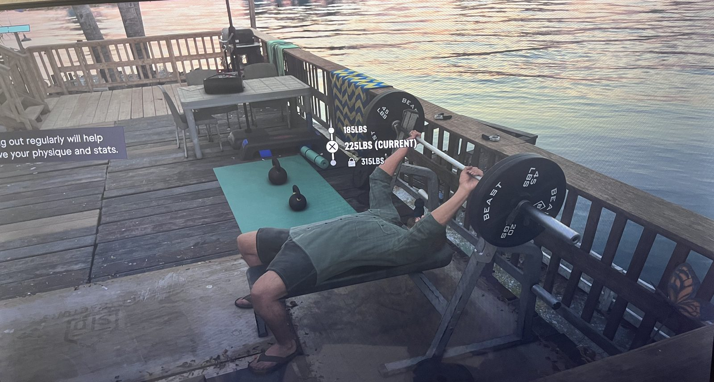
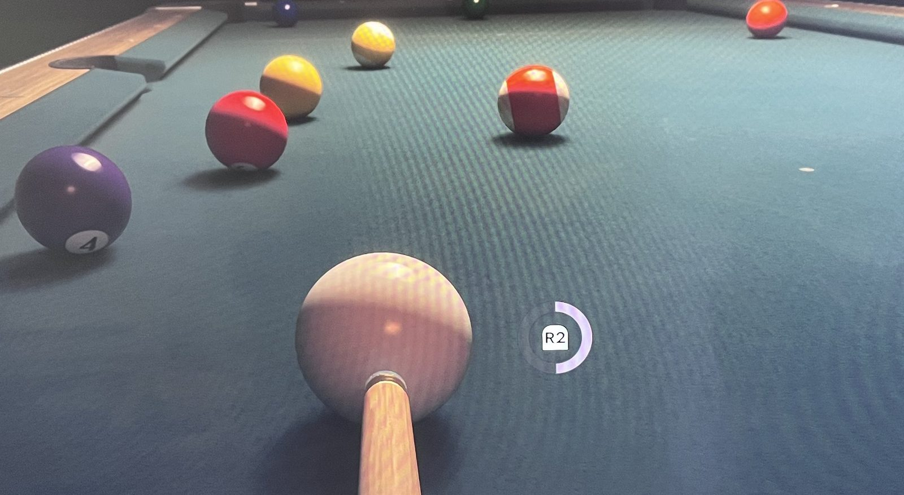
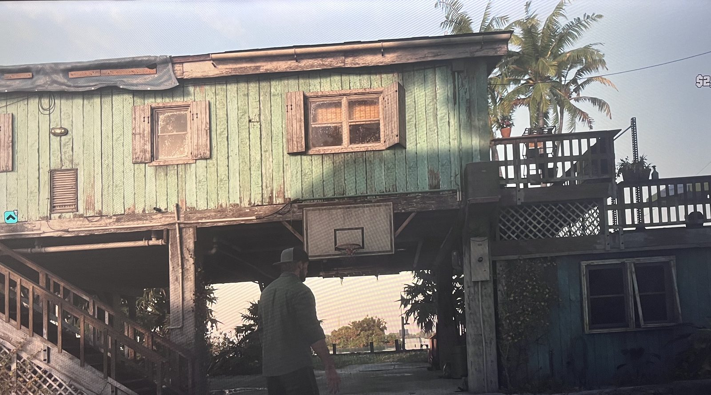

**GTA 6 has plenty to do between missions.** We've played pool, shot hoops and lifted weights so far. Lifting weights isn't just for fun: it builds your character's **strength and physique**.

## Lifting weights (Strength)

- You can work out on a **bench press**. Ours was on a waterfront deck.
- **Pick a weight:** ours offered **185 lbs**, **225 lbs (current)** and **315 lbs (locked)**. Heavier weights unlock as you get stronger.
- The game's tip: working out regularly **will help improve your physique and stats**.
- Your progress shows in the pause menu's **Strength** level and body stats. See our [pause menu guide](article:gta-6-pause-menu-stats-progress).

## Pool

- Pool plays from a **first-person view** behind the cue ball.
- **Hold R2** to set the power of your shot (the ring next to the ball fills up).

## Basketball

- You can **shoot hoops**. We found a court under a stilt house by the water.
- A **basketball icon** shows in the top-right corner while you play.

More activities are on the Progress tab of the pause menu, which has an **Activities** category to track them.
