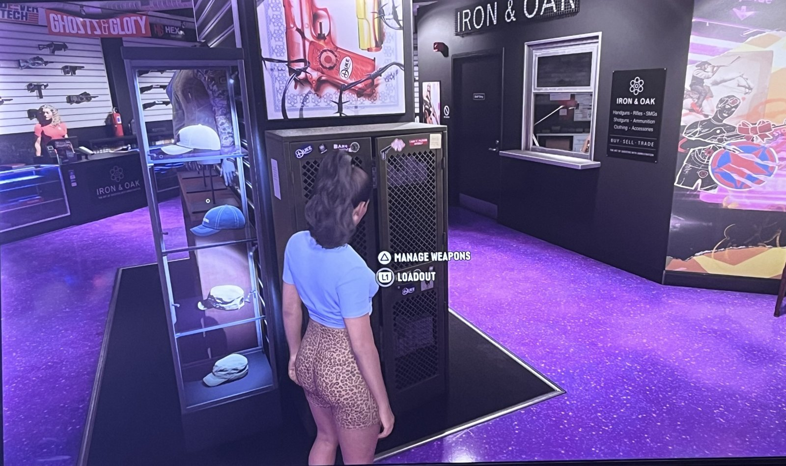
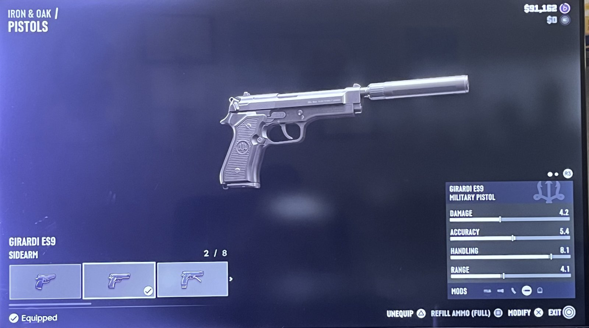

**Ammu-Nation is where you buy guns in GTA 6, but not every store sells everything.** Here's what's there and what it costs, with no story spoilers.

> [!REPORTED]
> Prices come from players reading the in-game store cards (sources below). They may change with patches, so check in the store before saving up.

## Inside a gun store (our PS5)

The gun store we used was **Iron & Oak** (Bayside). Its sign lists handguns, rifles, SMGs, shotguns, ammunition, clothing and accessories, and "buy, sell, trade". The **gun locker** lets you **Manage Weapons** (Triangle) or set your **Loadout** (L1).

In the menu, each gun shows **Damage, Accuracy, Handling and Range**. You can **Refill Ammo** (Square), **Modify** it with mods like a **suppressor** (X), or unequip it.

## Which store to visit

- Players count **24 Ammu-Nation** stores across Leonida.
- Only **6 bigger stores** sell **sniper rifles and launchers**. Find them on the map's weapons tab (the gun icon).
- Some stores sell **unique versions** of guns you can't get elsewhere.

## Reported prices

| Weapon | Type | Price |
| --- | --- | --- |
| Combat Knife | Melee | ~$285 |
| Klose K17 | Pistol | ~$975 |
| Koslov KZ59 | Assault rifle | ~$1,250 |
| Foyer VF5 Compact | SMG | ~$2,600 |
| Foyer FG1 | Assault rifle | ~$3,700 |
| Fortune & Son Laird 350 | Sniper | ~$950 |
| Fairview FF-50 | Sniper | ~$3,975 |
| Hillinger Boomer | Grenade launcher | ~$12,000 |
| Deever Tech GLR40 | Grenade launcher | ~$15,500 |
| Hauners H-AT | Rocket launcher | ~$16,000 |

## Free guns first

Before you spend, grab the free stuff: the legendary **Assassin Nipper .38** silenced pistol and a **shotgun** are out in the Keys. See [free silenced pistol](article:gta-6-silenced-pistol-assassin-nipper).

## Tips

- Switch weapons on the **weapon wheel** (hold **L1**).
- Need cash for the big guns? See [how to make money](article:gta-6-how-to-make-money).
- Prefer your fists? See [fighting](article:gta-6-fighting-weave-tackle).
