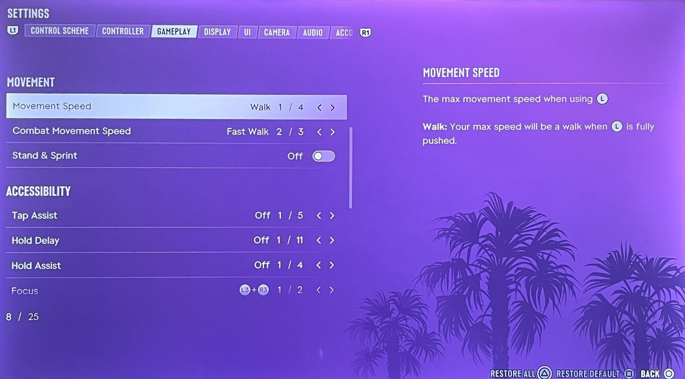
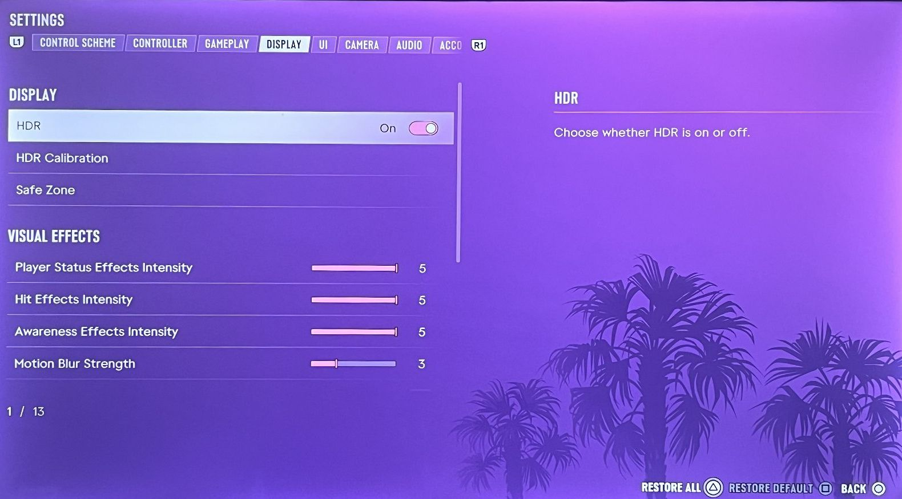
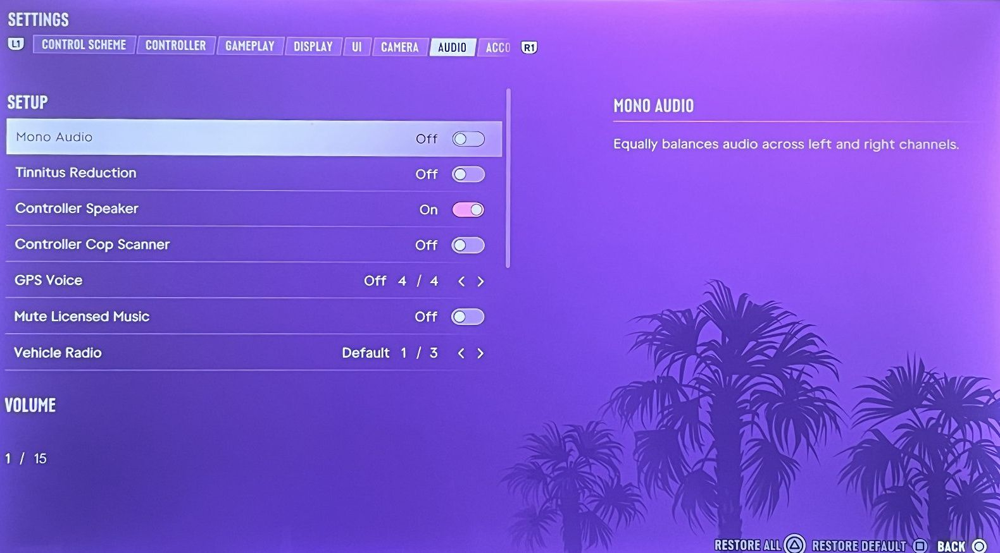

**Change Movement Speed first.** On our PS5 it was set to **Walk**, so pushing the stick all the way only walks. Then turn on **Subtitles**, and if you record or stream, switch on **Mute Licensed Music**. There's **no performance or quality mode** in the game's Display settings.

> [!CONFIRMED]
> Everything here comes from GTA VI's own settings menu on our PS5, photographed on launch night (November 19, 2026). Values are what our console showed then; "tips" are our suggestions, not Rockstar's.

## The settings to change first

| Setting | Where | What ours showed | Tip |
| --- | --- | --- | --- |
| Movement Speed | Gameplay → Movement | Walk (1 of 4) | Pick a faster option if walking feels slow. Rockstar: "Your max speed will be a walk when L is fully pushed." |
| Subtitles | UI → Subtitles & Captions | Off (1 of 3) | Turn on if you miss dialogue. |
| Mute Licensed Music | Audio → Setup | Off | Turn on before recording or streaming. |
| Targeting | Gameplay → Combat | Partial (2 of 3) | Partial: "Aiming will move towards a nearby target but will not lock on." |
| Aim Assist Strength | Gameplay → Combat | 4 | Raise for more help, lower for more control. |
| Motion Blur Strength | Display → Visual Effects | 3 | Lower it if you get motion sick or want a sharper image. |
| Camera Shake / Camera Bob | Camera → Comfort | On / 10 | Turn down for comfort. |
| Cinematic Kill Shot / Vehicle Crash Frequency | Camera → Cinematic | 3 / 3 | Lower to see fewer slow-motion moments. |

## Graphics: is there a performance mode?

Not in the game's own menu. The **Display** tab has 13 options and none of them is a performance or quality mode:

- **Display:** HDR (on/off), HDR Calibration, Safe Zone.
- **Visual effects:** Player Status Effects Intensity, Hit Effects Intensity, Awareness Effects Intensity (all 5 on ours), Motion Blur Strength (3).
- **Content:** Dismemberment (on/off), Blood & Gore Intensity (3 levels; ours was High), Flashbang (2 options; ours was Bright).
- **Accessibility:** Focus Trail Colorblind Mode, Brightness Reduction, High Contrast Shaders ("Applies a high contrast color to entities and interactions in world").

**Tip:** if colors look washed out or too dark, run **HDR Calibration** once.

## Every settings tab at a glance

The menu has eight tabs. Switch tabs with **L1** and **R1**.

| Tab | Options | What's in it |
| --- | --- | --- |
| Control Scheme | 9 | 3 control presets, plus layout previews. See [GTA 6 controls](article:gta-6-controls-ps5-xbox). |
| Controller | 19 | Aim and look sensitivity, inverted controls, DualSense features |
| Gameplay | 25 | Combat, movement, accessibility |
| Display | 13 | HDR, safe zone, visual effects |
| UI | 66 | Text size, subtitles, minimap, reticle, HUD, notifications, units |
| Camera | 24 | On foot, vehicles, comfort, aircraft, underwater, cinematic |
| Audio | 15 | Setup, volume, narration |
| Account | 9 | Rockstar Games account, GTA+ Boosts, legal |

## Controller

- **Aim & look sensitivity:** Horizontal/Vertical Look Sensitivity, Horizontal/Vertical Aim Sensitivity, Look Acceleration, Aim Acceleration (all 7 on ours), and Aim Response Curve (4 options; ours was Standard).
- **Inverted controls:** Look, Movement and 3D Map Rotation (4 options each), plus Aircraft Movement (on).
- **DualSense features:** Vibration & Haptics Strength (10), left and right stick Deadzone (4 each), Adaptive Triggers Resistance, Adaptive Triggers Vibration, Touch Pad Button (ours opened the Map) and Light Bar Effect.
- **Adaptive Speed Limiter** (on, on ours): "Maintains the vehicle at a reasonable speed for the road you're on when you hold R2 to the resistance point." Handy for cruising.

## Gameplay

- **Combat:** Targeting, Aim Assist Strength, Shooting Assist, Drive-By Assist, Quick Draw, Cover Selection (ours: Camera & Movement), Holster in Vehicle (ours: Automatic).
- **Movement:** Movement Speed, Combat Movement Speed (ours: Fast Walk), Stand & Sprint.
- **Accessibility:** Tap Assist, Hold Delay, Hold Assist, Focus (L3 + R3 on ours), hold or press for Directional Button Actions, Aiming, Interact, Loadout and Nitrous, a Fishing control option, Simplified Mini Games, Auto Drive (ours: Restricted), Auto Equip Helmet, Accessible Combat and Reduced Vehicle Damage.
- **Accessible Combat** "reduces enemy health and damage taken by your character." Rockstar warns it "will significantly change the balance and experience of gameplay."

## UI (HUD)

- **Scaling & readability:** Language (12), UI Text Size (4; ours was Small), Color Adjustments, Map Blip Size, Minimap Blip Size, In-World Marker Size.
- **Navigation:** Minimap and Compass (ours: Dynamic), Minimap Size, GPS Route, GPS Turn Indicators, In-World Markers, Door Markers, Interaction Markers, Altimeter.
- **Reticle:** Persistent Center Dot, Reticle Hit Markers, Reticle Size, Reticle Shape (4 options), reticle visibility sliders, Reticle Messages and Projectile Arc.
- **Combat HUD:** Weapon Preview, Ammo, Threat Indicators, Damage Region Highlights.
- **HUD notifications:** Ticker Feed, Criminal Profile, Relationship, Help Text, Reminder Tips, Objective, Mission Update, Phone Notifications. Rockstar warns that turning **Objective** off "will make parts of the game much more difficult to play."
- **Player & vehicle status:** Player Vitals, Wanted Stars, Heat Indicators, Money, Vehicle Name & Status.
- **Units of measurement:** Distance, Weight, Temperature and Clock Format (ours: Imperial, Pounds, Fahrenheit, 12 Hour).

## Camera

- **On foot and vehicles:** camera Height (ours: Medium), follow speeds and follow delays for driver and passenger.
- **Comfort:** Camera Preferences (remembers your camera for on foot, vehicles, bikes, boats and aircraft), Weapon Sway, Camera Shake, Camera Bob, Phone Display.
- **Aircraft and underwater:** follow speeds and roll options.
- **Cinematic:** Cinematic Kill Shot Frequency, Cinematic Vehicle Crash Frequency (slow-motion moments), Idle Camera.

## Audio

- **Setup:** Mono Audio, Tinnitus Reduction, Controller Speaker, Controller Cop Scanner, GPS Voice, **Mute Licensed Music**, Vehicle Radio.
- **Volume:** Master, SFX, UI, Dialogue, Music and Media sliders (all 10 on ours).
- **Narration:** Screen Narration and **Audio Descriptions** for cutscenes (English only).

## Account

Customer Support, Rockstar Games Account, **GTA+ Boosts** (shown locked on ours), Credits, and the legal pages.
