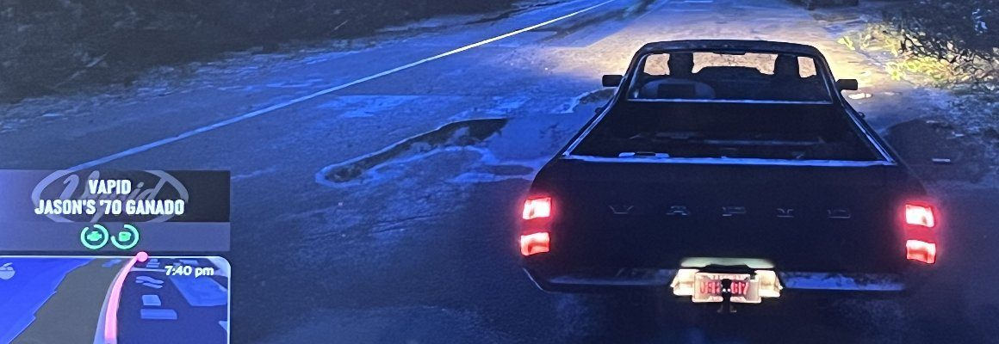
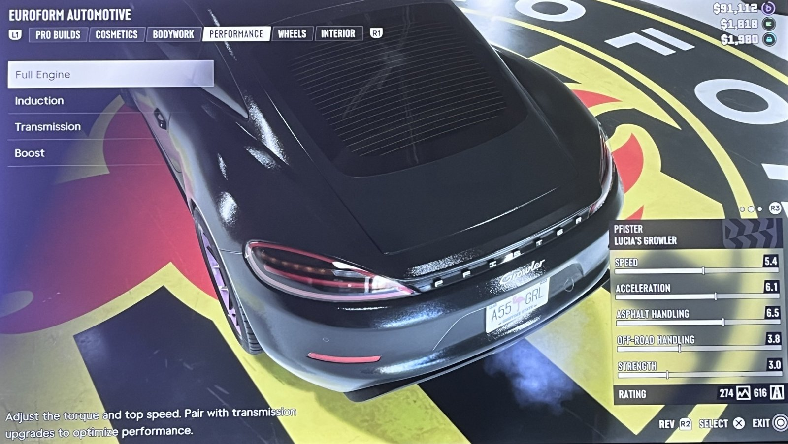
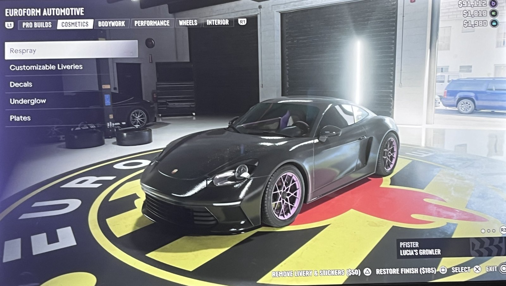
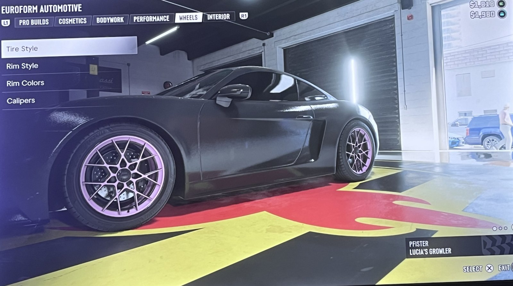
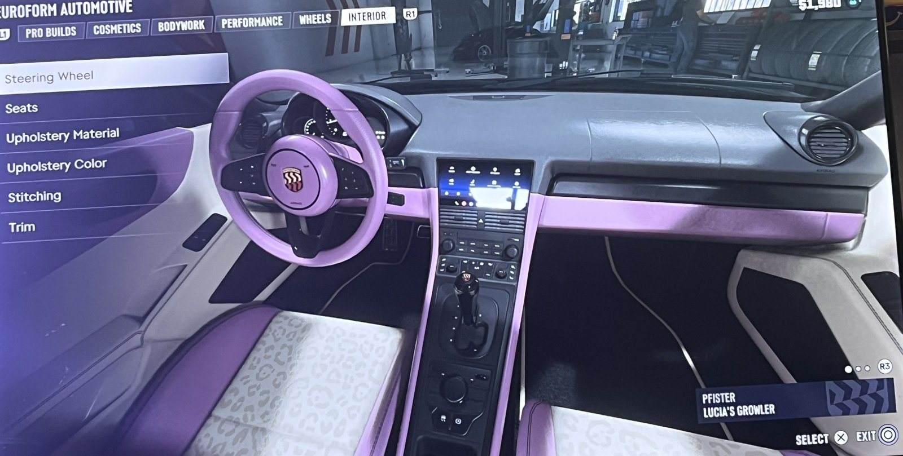
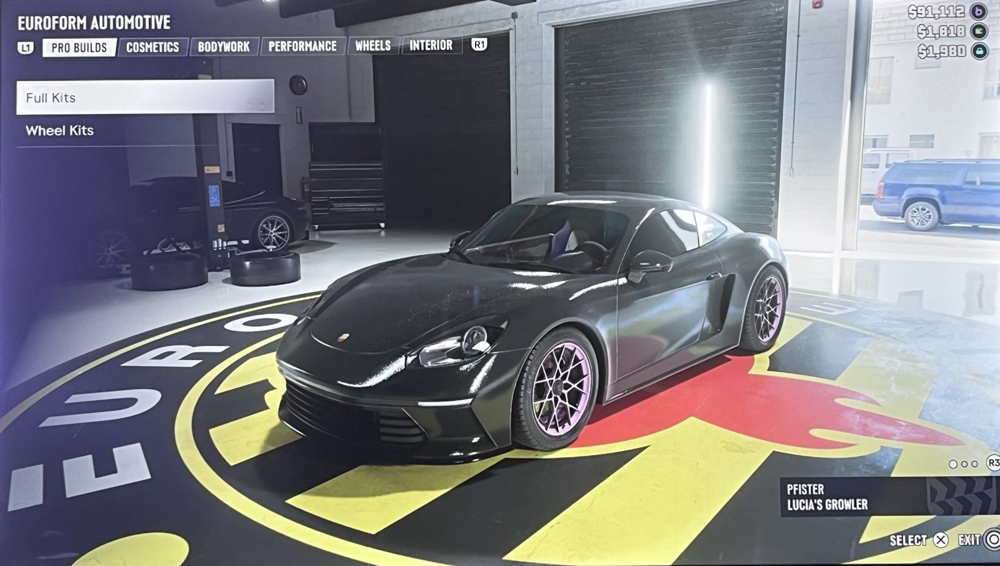
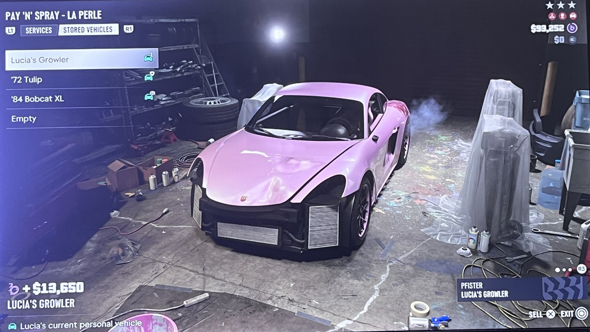

**You can customize cars in GTA 6 at mod shops, from engine upgrades to new wheels.** Here's how it works, with no story spoilers.

> [!REPORTED]
> From guides by people playing the game (sources below); the Ultimate Edition shops are from Rockstar's official Editions page.

## Finding a mod shop

Open the map and pick the **Vehicles** tab (the car icon). On our copy it lists **Mod Shops**, **Pay 'n' Sprays**, **Gas Stations**, **Car Washes**, **Electric Chargers** and **Garages**; pick one to see the nearest.

## Mod shops: every tab (our PS5)

We took Lucia's Growler to **Euroform Automotive**, a mod shop. Switch tabs with **L1 / R1**:

| Tab | What's in it |
| --- | --- |
| **Pro Builds** | **Full Kits** and **Wheel Kits**: ready-made looks in one go |
| **Cosmetics** | **Respray**, **Customizable Liveries**, **Decals**, **Underglow**, **Plates** |
| **Bodywork** | **Hood, Spoiler, Front Bumper, Rear Bumper, Towing, Mirrors, Windows, Roof** and more (12 options) |
| **Performance** | **Full Engine, Induction, Transmission, Boost** |
| **Wheels** | **Tire Style, Rim Style, Rim Colors, Calipers** |
| **Interior** | **Steering Wheel, Seats, Upholstery Material, Upholstery Color, Stitching, Trim** |

### Performance and the car's stats

The Performance tab shows the car's **Speed, Acceleration, Asphalt Handling, Off-Road Handling** and **Strength**, plus an overall **Rating**, so you can see what each part changes. The game's tip: engine upgrades "adjust the torque and top speed. Pair with transmission upgrades to optimize performance." Hold **R2** to **rev** the engine.

### Cosmetics: paint, liveries and underglow

You can also **Remove Livery & Stickers** (ours was **$50**) or **Restore Finish** (**$185**).

### Wheels and interior

### Pro Builds

Short on time? **Pro Builds** apply a full kit or a wheel kit in one step.

**Tip:** players report some shops make you **repair** the car before you can mod it.

## Pay 'n' Spray: repairs and paint

On our PS5, a **Pay 'n' Spray** has two tabs:

- **Services:** **Repair** (ours cost **$1,100**: "repairs engine and collision damage"), **Respray**, **Register** (make a car yours) and **Sell**.
- **Stored Vehicles:** the cars you've stored there, with what each would **sell** for.

- **Pay 'n' Spray** doesn't do performance upgrades: that's the mod shop.
- A fresh coat of paint can help when the police remember your car: see [wanted level](article:gta-6-wanted-level).

## Ultimate Edition shops

Rockstar's Ultimate Edition lists two extra mod shops, **Rideout Customs** and **One-Eyed Willie's**. Standard Edition players can still use the regular mod shops. See [editions](article:gta-6-editions-standard-vs-ultimate).

## Related

- Where to keep your cars: [garages and properties](article:gta-6-garages-properties).
- Cars found so far: [vehicles guide](article:gta-6-vehicles-named-so-far).
