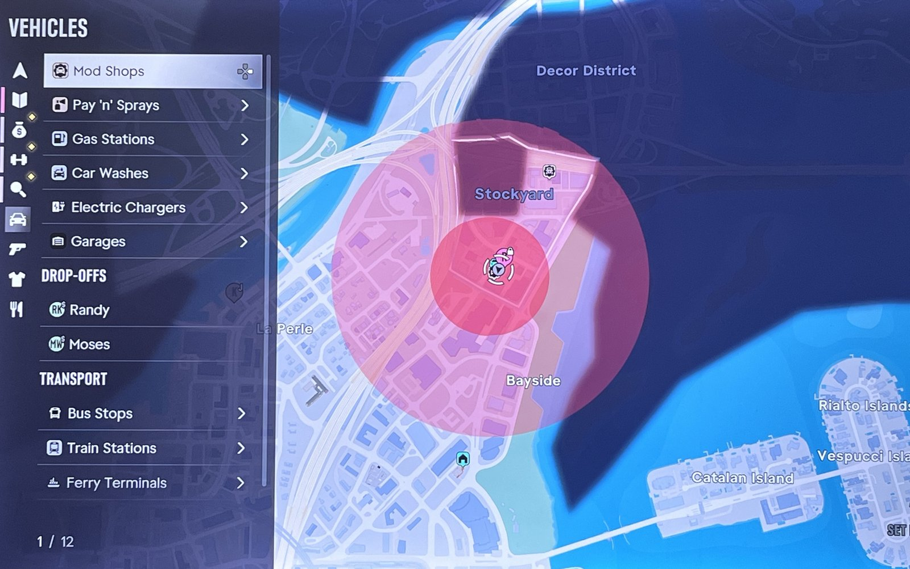
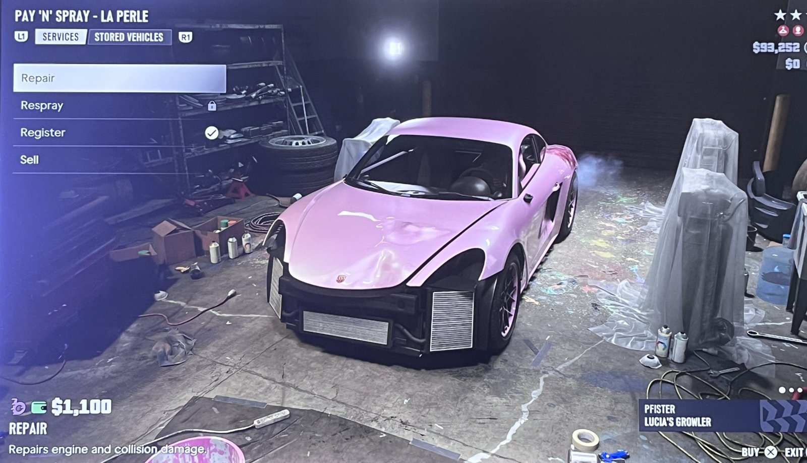

**You can customize cars in GTA 6 at mod shops, from engine upgrades to new wheels.** Here's how it works, with no story spoilers.

> [!REPORTED]
> From guides by people playing the game (sources below); the Ultimate Edition shops are from Rockstar's official Editions page.

## Finding a mod shop

Open the map and pick the **Vehicles** tab (the car icon). On our copy it lists **Mod Shops**, **Pay 'n' Sprays**, **Gas Stations**, **Car Washes**, **Electric Chargers** and **Garages**; pick one to see the nearest.

## Mod shops: upgrades

1. Drive to a **mod shop** (look for its icon on the map).
2. **Repair** the car first if the shop asks.
3. Pick a category and choose parts, then pay.

Upgrade categories reportedly include **Performance**, **Bodywork**, **Wheels** and **Interior**. Some upgrades trade one stat for another, so compare the numbers before you buy.

## Pay 'n' Spray: repairs and paint

On our PS5, a **Pay 'n' Spray** has two tabs:

- **Services:** **Repair** (ours cost **$1,100**: "repairs engine and collision damage"), **Respray**, **Register** (make a car yours) and **Sell**.
- **Stored Vehicles:** the cars you've stored there, with what each would **sell** for.

- **Pay 'n' Spray** doesn't do performance upgrades: that's the mod shop.
- A fresh coat of paint can help when the police remember your car: see [wanted level](article:gta-6-wanted-level).

## Ultimate Edition shops

Rockstar's Ultimate Edition lists two extra mod shops, **Rideout Customs** and **One-Eyed Willie's**. Standard Edition players can still use the regular mod shops. See [editions](article:gta-6-editions-standard-vs-ultimate).

## Related

- Where to keep your cars: [garages and properties](article:gta-6-garages-properties).
- Cars found so far: [vehicles guide](article:gta-6-vehicles-named-so-far).
