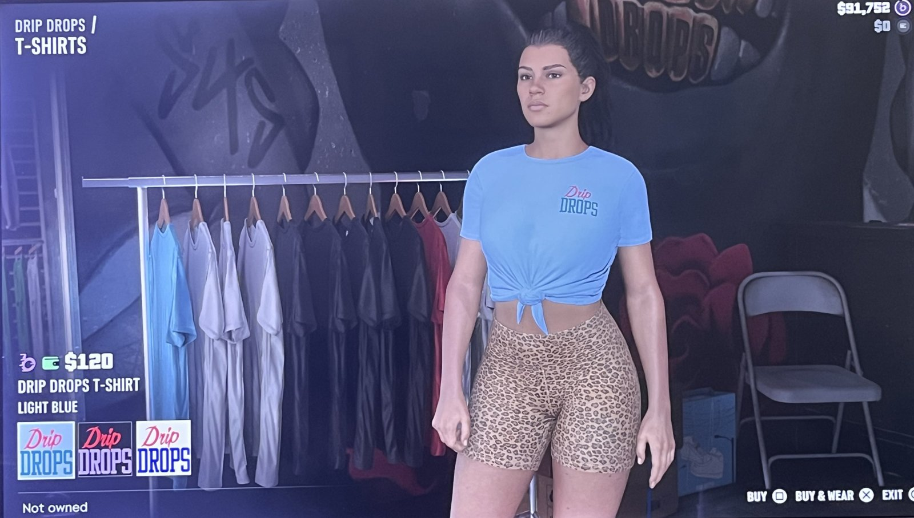

**You can change your clothes, hair and tattoos in GTA 6,** and a new look can even help you lose the cops. Here's how, with no story spoilers.

> [!REPORTED]
> From guides by people playing the game (sources below). Guides disagree on how many outfits you can save, so we've noted both numbers.

## Where to change clothes

| Where | What you can do |
| --- | --- |
| **Home wardrobe** | Change into anything you own and save outfits (guides say 10–15 slots) |
| **Clothing store** | Buy new clothes and change in the **fitting room** |
| **Car trunk** | Swap outfits on the go: reportedly **up to 5** per character, only in a car **registered to you** |

Clothes you buy stay **unlocked for good**.

In a store, pick an item to **try it on**, then **Buy** (Square) or **Buy & Wear** (X). Our Drip Drops T-shirt cost **$120**.

## Haircuts

- At home you can only go **shorter** (cut or shave).
- For a **new style**, visit a **barber or salon**. Players say switching back to an old cut costs again.

## Tattoos

Players report the **Electric Fang Tattoo** parlor (with 50+ designs) is part of the **Ultimate Edition**. See [Standard vs Ultimate](article:gta-6-editions-standard-vs-ultimate).

## Lose the police with a new look

Police describe you by your **clothes**, your **car** and whether you're together. Change your outfit (and car) to shake a description. See [wanted level](article:gta-6-wanted-level).

## Body shape

Your **body** changes too: eat more and you gain weight, work out and you build muscle. See [eating, sleeping and fitness](article:gta-6-eat-sleep-fitness).
