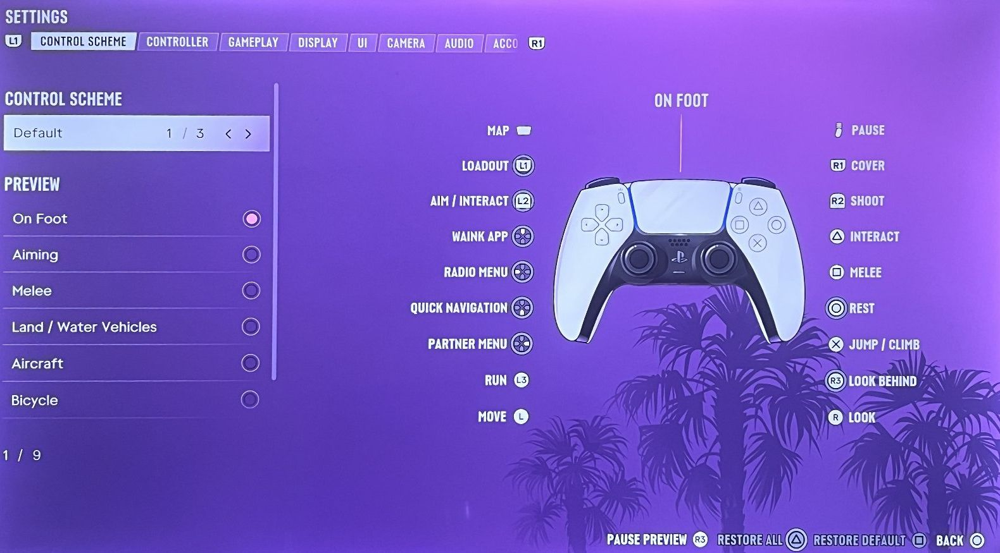

**GTA VI's default PS5 controls on foot: R2 shoots, L2 aims (and interacts), R1 takes cover, X jumps or climbs, L3 runs and the touch pad opens the map.** This is the game's own **Default** control scheme, read straight from the settings menu on launch night.

> [!CONFIRMED]
> Taken from GTA VI's Control Scheme screen on our PS5 (Default scheme, On Foot preview), November 19, 2026. Xbox controls are coming once we've checked them on an Xbox.

## Default on-foot controls (PS5)

| Button | Action |
| --- | --- |
| Left stick | Move |
| L3 (click left stick) | Run |
| Right stick | Look |
| R3 (click right stick) | Look behind |
| R2 | Shoot |
| L2 | Aim / interact |
| R1 | Cover |
| L1 | Loadout |
| X | Jump / climb |
| Square | Melee |
| Triangle | Interact |
| Circle | Rest |
| Touch pad | Map |
| Options | Pause |
| D-pad | Waink app, radio menu, quick navigation and partner menu (one direction each) |

## Control presets and previews

- **3 control schemes:** Settings → Control Scheme. **Default** is the first of three.
- **Previews** show the layout for: On Foot, Aiming, Melee, Land / Water Vehicles, Aircraft, Bicycle, Swimming and Parachute.
- Press **Triangle** to restore all, or **Square** to restore one default.

## Controls worth changing

- **Movement speed:** ours was set to **Walk**, which caps you at a walk even with the stick fully pushed. Change it in Settings → Gameplay → Movement Speed.
- **Hold or press:** Settings → Gameplay lets you switch Aiming, Interact, Loadout, Nitrous and Directional Button Actions between hold and press.
- **Focus** is on **L3 + R3** by default, with one alternative.
- **Map button:** the touch pad can be changed in Settings → Controller → Touch Pad Button.

Fighting moves (punch, grab, choke, body slam, tackle) are in our [GTA 6 fighting guide](article:gta-6-fighting-weave-tackle).

For every other option, see our [GTA 6 settings guide](article:gta-6-best-settings).
