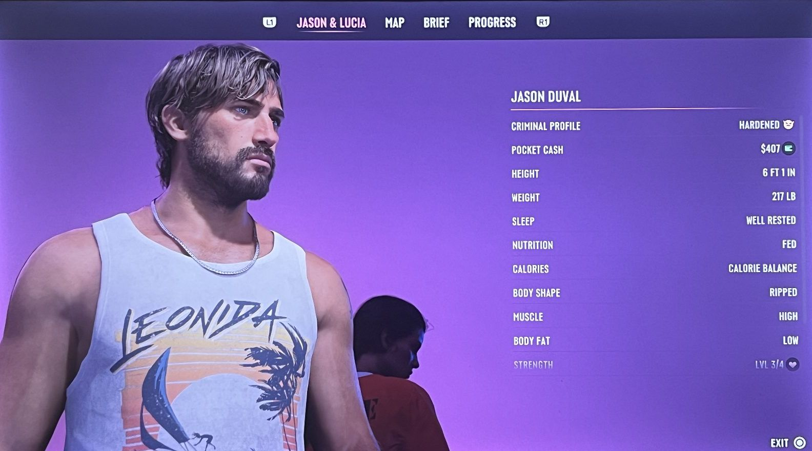

**Yes, GTA 6 tracks eating, sleeping and fitness,** for both Jason and Lucia. Here's how it works, with no story spoilers.

> [!REPORTED]
> The stats are from the pause menu on our own PS5 copy. What food, sleep and the gym do comes from players' guides (sources below); exact numbers haven't been published.

## What the game tracks

On the **Jason & Lucia** tab of the pause menu, each character has: **Sleep** (e.g. Well Rested), **Nutrition** (e.g. Fed), **Calories**, **Body Shape**, **Muscle**, **Body Fat** and **Strength** (level 1–4). See every stat in our [pause menu guide](article:gta-6-pause-menu-stats-progress).

## Eating (reported)

- Eating or drinking gives a **short boost** to health, stamina or Focus, handy before a job.
- Eat **more calories than you burn** and you'll **gain weight**, like San Andreas.

## Sleeping (reported)

- Go too long without sleep and your character **looks worn out**.
- Sleep helps you **recover after workouts**.
- Sleeping **doesn't save** your game: see [how to save](article:gta-6-how-to-save).

## Working out

- Lifting weights at the gym builds **muscle** and raises **Strength**. See [activities](article:gta-6-activities-pool-basketball-gym).
- Players report the bonuses **fade** if you stop training.
- More strength helps in a scrap: see our [fighting guide](article:gta-6-fighting-weave-tackle).
