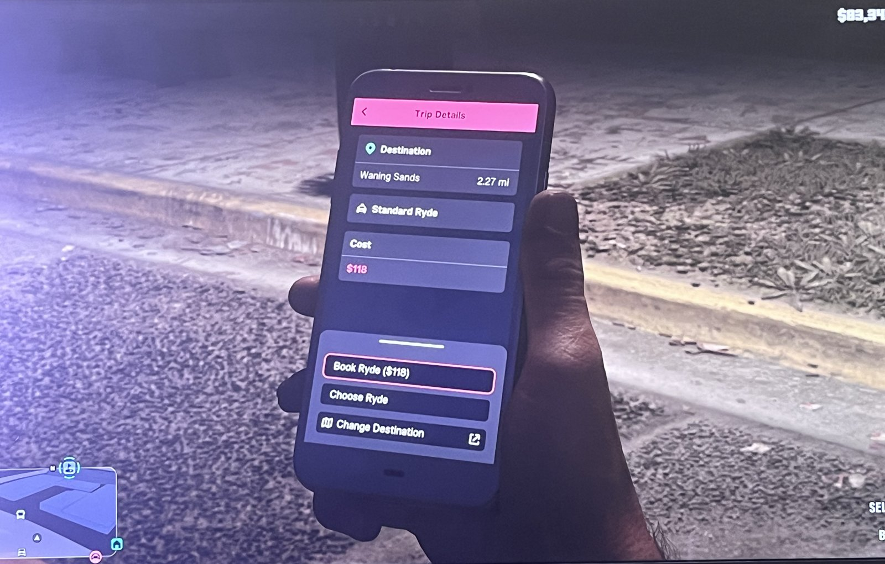
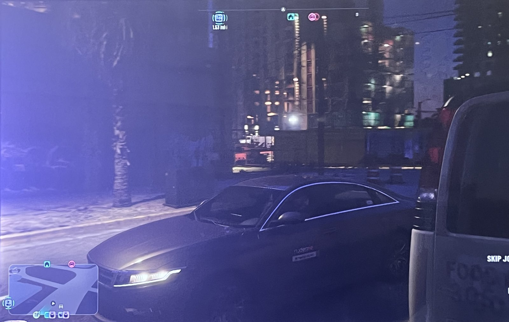
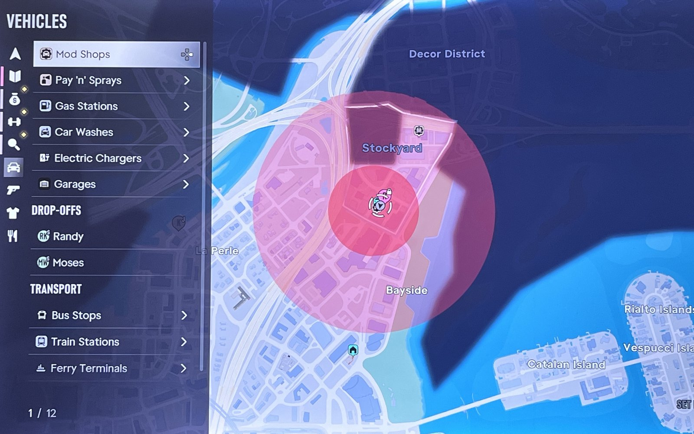

**GTA 6 doesn't let you fast travel from the map, but taxis and the RydeMe app get you across Leonida quickly.** Here's how, with no story spoilers.

> [!REPORTED]
> From guides by people playing the game (sources below). Prices and unlock times may change with patches.

## Option 1: Paradise Taxi (early game)

1. Set a **waypoint** on the map where you want to go.
2. Open your phone (**D-pad up**), go to **Contacts** and call **Paradise Taxi**.
3. Get in the back.

Taxis are reportedly available after the **first mission**, and you pay with the **cash you're carrying**, so you may need an ATM.

## Option 2: RydeMe (from Chapter 2)

- The **RydeMe** app unlocks as you progress the story (Chapter 2).
- It's reportedly **faster** than calling a taxi, and it charges your **bank account** instead of cash.

### Booking a RydeMe (our PS5)

1. Set a destination, then open **RydeMe** on your phone.
2. **Trip Details** shows the **destination**, **distance**, ride type (**Standard Ryde**) and the **cost**. Ours was **$118** for **2.27 miles**.
3. Tap **Book Ryde**. You can also **Choose Ryde** for a different car or **Change Destination**.

The car pulls up and shows a **Skip** prompt so you can jump to the end of the trip.

## Skip the drive

In a taxi or RydeMe car:

1. **Hold L2** (LT on Xbox) to talk to the driver.
2. Press **Triangle** (Y on Xbox) to **skip** the trip.

It reportedly costs about **$100**. Ride the whole way and you don't pay the skip fee.

## Other ways around

- **Buses, trains and ferries** run around Leonida, but you can't call them. The map's **Vehicles** tab lists every **Bus Stop**, **Train Station** and **Ferry Terminal** (confirmed on our copy):

- **Your own car:** remember to [refuel](article:gta-6-gas-refuel). You can [use your phone while driving](article:gta-6-phone-while-driving).
