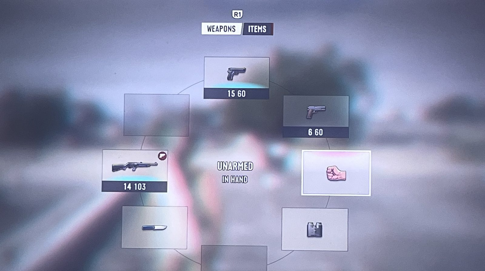

**Fighting in GTA 6 is more than mashing punch.** You can throw punches, **weave** to dodge, and **tackle** someone who tries to run. Here's how, from our own PS5 copy.

## Get ready to fight

- To fight with your fists, pick **Unarmed** (the fist) on the **weapon wheel** (hold **L1**).
- **Square** is **melee** in the default PS5 controls. See our [controls guide](article:gta-6-controls-ps5-xbox).

## Punch

Press **melee** to throw punches. Keep pressing to string hits together.

## Weave to dodge

You can **weave** to slip an incoming punch, then hit back while they're open.

> [!NOTE]
> We haven't pinned down the exact weave button yet. We'll add it, plus a video, once we've recorded it.

## Tackle someone who runs

If someone runs away from a fight:

1. **Sprint** after them (**L3** to run).
2. When you're close, press **melee**.
3. Your character **tackles them to the ground**.

## Tips

- **Fighting in public draws police.** Watch your [wanted level](article:gta-6-wanted-level).
- **Get stronger:** lifting weights raises your **Strength** stat. See [GTA 6 activities](article:gta-6-activities-pool-basketball-gym).
