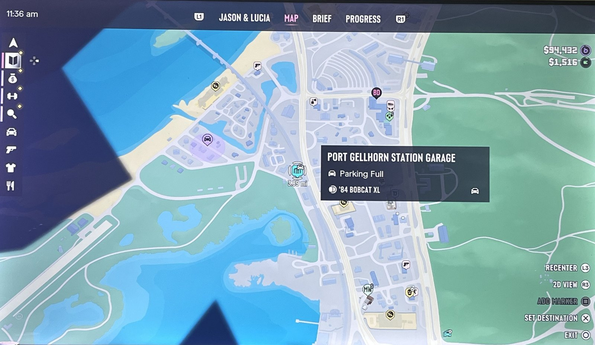

**In GTA 6 you can buy garages for your cars, but most other property isn't for sale.** Here's what players have found so far, without story spoilers.

> [!REPORTED]
> Prices and counts come from guides written by people playing the game (sources below). We'll confirm them on our own copy.

## Garages

- Guides report **12 garages** in the base game: about **8 you buy with cash** and **4 you're given** as you play.
- Bought garages reportedly cost about **$4,000 to $40,000** each.
- They reportedly become available **from Chapter 2**.

On our map, **Port Gellhorn Station Garage** shows **Parking Full** and the car stored in it. Your phone's **My Vehicles** screen also lists what's in your garage.

## Safehouses

- **Safehouses aren't for sale.** They unlock as you progress the story.

## Businesses

- **Not confirmed.** Guides haven't found businesses you can buy in story mode yet.
- The **Ultimate Edition** lists extra places like mod shops and a compound: see [editions](article:gta-6-editions-standard-vs-ultimate).

## Tips

- Need the cash first? See [how to make money](article:gta-6-how-to-make-money).
- The vehicles we've found so far are in our [vehicles guide](article:gta-6-vehicles-named-so-far).
