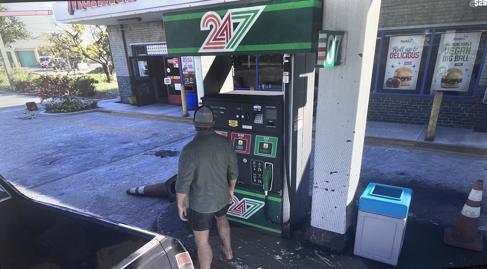
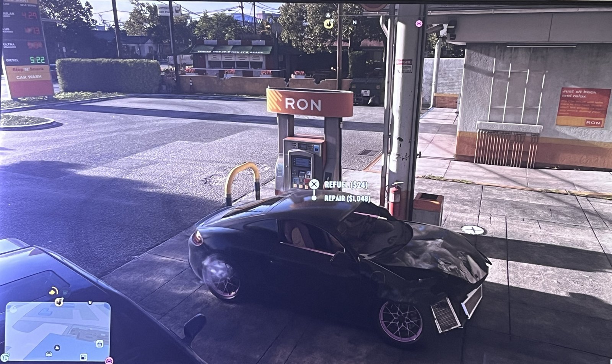
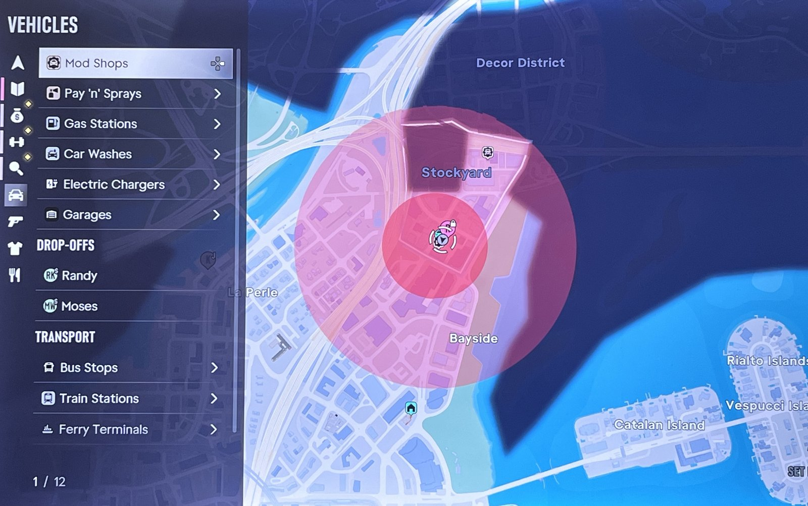
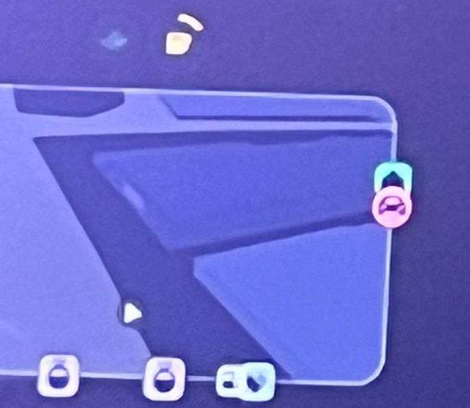
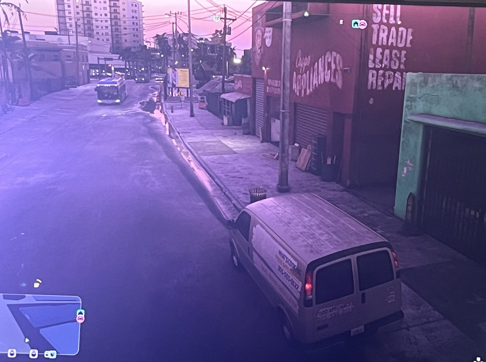

**Yes: cars in GTA 6 need gas.** Unlike earlier GTA games, you have to keep an eye on fuel and stop to refuel.

## How to refuel, step by step

1. Find a gas station: open the map, pick the **Vehicles** tab (car icon) and choose **Gas Stations**.
2. Park right **next to a pump**.
3. The prompt shows **Refuel** with the price, and **Repair**. Press **X** to refuel.

Ours, at a **RON** station, said **Refuel ($24)** and **Repair ($1,048)** for a banged-up car. Players report fill-ups run about **$12–$39**, depending on the car and how empty it is.

## Electric cars

Electric cars **can't use gas pumps**. Use an **Electric Charger** instead: they're listed right under Gas Stations on the map's Vehicles tab.

## Where to refuel

- Pull up to a **gas pump**. We used one at a **24/7** store.
- The pumps have regular, mid-grade and premium options, like a real station.

## How to check your fuel

When you get in a car, its name shows in the bottom-left corner with **status icons** underneath. On Jason's '70 Ganado we saw two green icons there, an engine and a fuel pump. See the picture in our [vehicles guide](article:gta-6-vehicles-named-so-far).

## The low fuel warning

When your tank gets low, a **yellow gas-pump icon** pops up just **above the minimap** (bottom left). That's your cue to find a station.

## What happens if you run out of gas?

> [!REPORTED]
> Players report the **engine cuts out** and the car rolls to a stop. Gas cans reportedly **don't** refuel cars (they're for starting fires). We haven't run dry ourselves yet, so we'll confirm this.

**Tip:** pumps also offer a quick **Repair**, but players say a [Pay 'n' Spray or mod shop](article:gta-6-car-customization) gives a fuller, cheaper fix.

## Tip

Gas stations double as stores. The 24/7 here had food ads in the windows, so it's worth stopping in.
