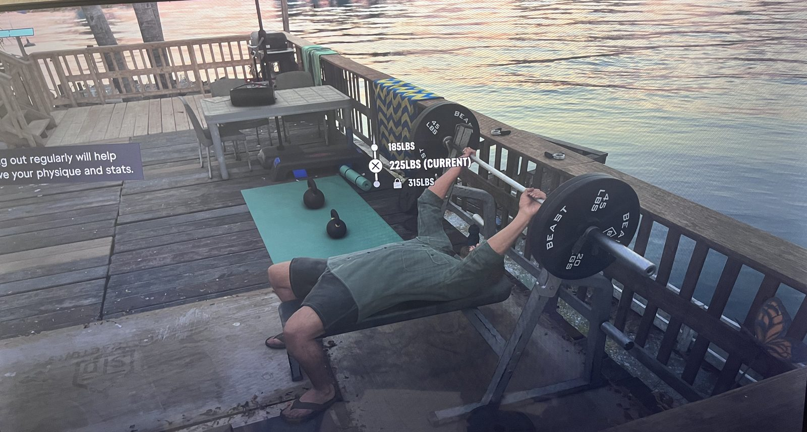

**Jason and Lucia each have three stats you can train: Strength, Cardio and Focus.** Here's how each works and how to raise it, with no story spoilers.

> [!REPORTED]
> The bench press and the 8 gym memberships are from our own PS5 copy. How each stat works comes from players' guides (sources below).

## The three stats (reported)

| Stat | What it does | How to raise it |
| --- | --- | --- |
| **Strength** | Raises your **max health** and hits harder | Lifting **weights** |
| **Cardio** | Raises your **max stamina** | **Running, cycling, swimming**, treadmills and bikes |
| **Focus** | Powers **Focus** (L3 + R3), including slowing time in gunfights | Using Focus, and **fishing** (each catch helps) |

Each goes up to **level 4**. Both characters train **separately**. Check them on the **Jason & Lucia** tab of the [pause menu](article:gta-6-pause-menu-stats-progress).

## Free weights first

You don't need a gym to start. On our copy, a **bench press** on a waterfront deck let us choose **185 lbs** or **225 lbs**, with **315 lbs locked** until we got stronger.

## Gyms (reported)

- Our **Progress → Stats** page tracks **Gym Memberships Purchased** out of **8**.
- Memberships are a **one-time fee**. Guides list one free gym on the beach and the priciest at about **$1,800**.
- Gyms add **treadmills and bikes** for Cardio on top of weights.

## Keep it up

- Players report stats can **slip** if you stop training for a while (Focus reportedly doesn't drop).
- Food and sleep help you recover: see [eating, sleeping and fitness](article:gta-6-eat-sleep-fitness).
- More Strength helps in a fight: see [fighting](article:gta-6-fighting-weave-tackle).
