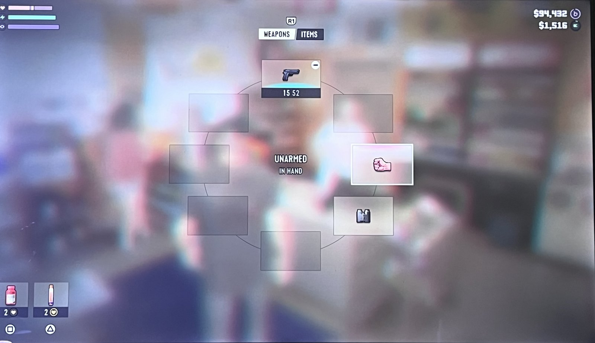
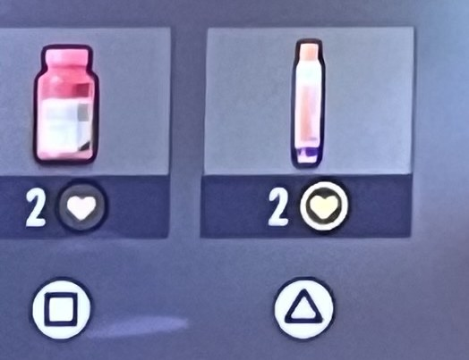

**Health doesn't fully come back on its own in GTA 6, so you need to carry healing items.** Here's how they work, with no story spoilers.

> [!REPORTED]
> The quick-use items on the weapon wheel are from our own PS5 copy. What each item does and the armor steps come from players' guides (sources below).

## Quick-use healing items

Hold **L1** to open the weapon wheel. In the bottom-left corner are two quick-use slots:

| Item | Button | What it does (reported) |
| --- | --- | --- |
| **Health pills** | **Square** | Restores health |
| **Adrenaline** | **Triangle** | A short boost to health, stamina and Focus |

Ours had **2 of each**. Players say you buy more at grocery stores or find them around Leonida.

## Other ways to heal (reported)

- **Health partly refills** if you stay out of trouble for a bit, but not all the way.
- **Food:** some food restores health, and some gives a little **extra** for a while. See [eating and sleeping](article:gta-6-eat-sleep-fitness).
- **Sleep** at a safehouse reportedly refills health fully.
- **Strength** raises your max health: see [gyms and stats](article:gta-6-gyms-strength-cardio-focus).

## Body armor (reported)

- Vests are sold at **gun stores**: see [Ammu-Nation](article:gta-6-ammu-nation-weapons). You can also find them in police cars, players say.
- **Equip it:** hold **L1**, press **R1** for the **Items** tab, and select the vest. A **blue bar** shows above your health.
- Healing items **don't** refill armor. When it's gone, you need a new vest.

More on staying alive in a scrap: [fighting](article:gta-6-fighting-weave-tackle).
