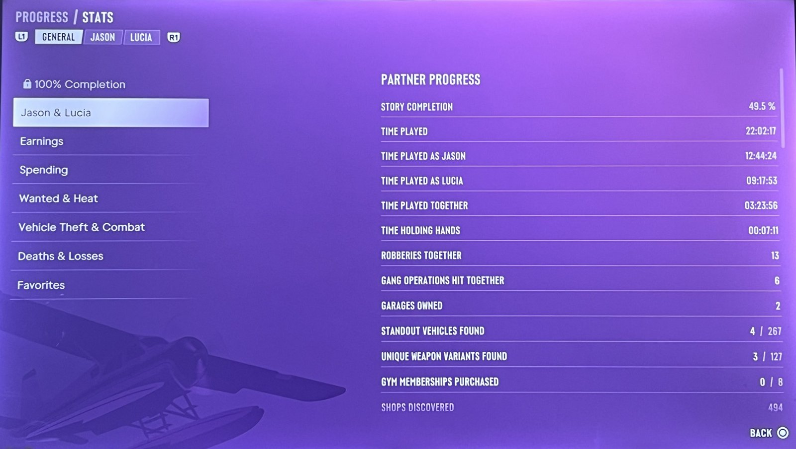

**GTA 6's main story takes about 50 to 60 hours, based on reports so far.** Add side activities and it's more like 70–110 hours. Finishing everything (100%) is estimated at around 200 hours. No spoilers here, just the numbers.

> [!REPORTED]
> Rockstar hasn't published an official length. These figures come from reviews and guides (sources below), and some were estimates made before launch. We'll update them as more players finish.

| How you play | Rough time |
| --- | --- |
| **Main story only** | About 50–60 hours |
| **Story + side content** | About 70–110 hours |
| **100% completion** | Around 200 hours |

## Our own pace

Our **Progress → Stats** page showed **49.5% story completion** after **22 hours** of play, with plenty of side stuff along the way. At that pace the story alone would take us roughly **45 hours**. Check your own under **Progress → Stats**.

## Why times vary so much

- **Side content is huge:** activities, collectibles and money-making all add up. See [activities](article:gta-6-activities-pool-basketball-gym) and [collectibles](article:gta-6-collectibles).
- **Driving vs. fast travel:** the map is big, and getting around takes time.
- **How you play:** rushing missions vs. exploring Leonida makes a big difference.

One reviewer reportedly finished the story in just under **51 hours** while skipping most of the side content.
