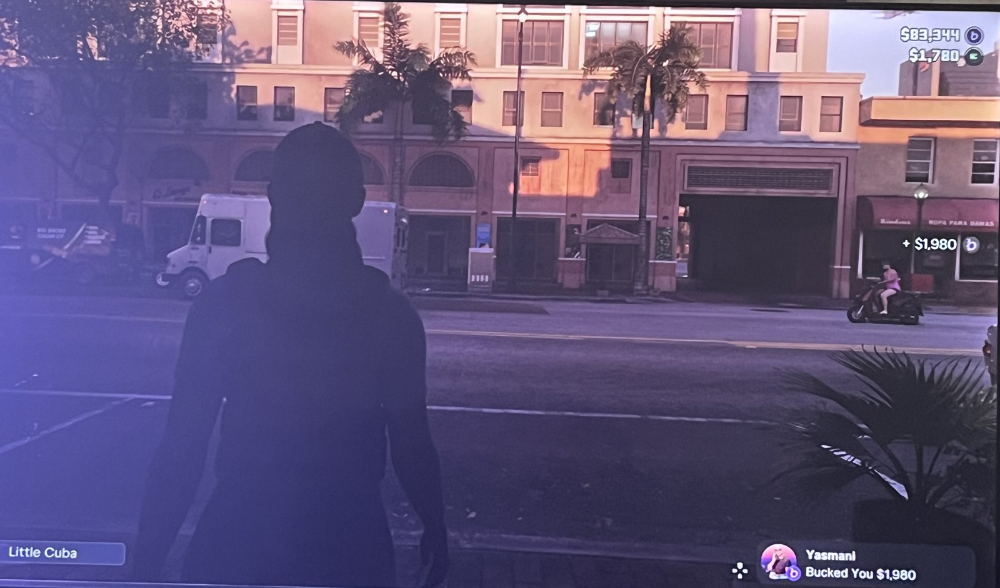

**Short on cash in GTA 6? These are the money makers players are reporting so far, early game first.** We've kept it to features only, with no story spoilers.

> [!REPORTED]
> Payouts and unlock points come from guides written by people playing the game (sources below). They don't all agree, so treat the numbers as rough. We'll confirm them on our own copy.

## Early game

| Method | What you do | Reported payout |
| --- | --- | --- |
| **Gang hideouts** | Clear out and loot a gang's stash spot, then sell the goods to a fence | About $1,000–2,000+ per site |
| **Delivery side jobs** | Drop off packages for a contact | About $900 per drop (one guide) |
| **Treasure diving** | Dive wrecks for valuables | About $1,400 per wreck early (one guide) |

## From Chapter 2: selling stolen cars

- A buyer contact takes **stolen cars**. Runs reportedly take just **3–5 minutes**.
- Guides disagree on whether there's a **daily limit**.
- Scan cars first with the [Waink app](article:gta-6-waink-app-car-scanner) so you pick ones that are easy to take.

## Where to find money jobs: the Robberies tab

The map's **Robberies** tab (money-bag icon) lists the illegal ways to earn on our PS5 copy: **Illegal Operations** (taking from gangs and common thieves), **Smash 'n' Grabs**, **Stick Ups**, and **drop-offs** where contacts pay for **stolen cars** and **goods**.

How to rob stores: see [stick-ups](article:gta-6-rob-stores-stick-ups). Stealing cars: see [how to steal cars](article:gta-6-how-to-steal-cars).

## How you get paid

Side jobs often pay straight into your **bank** through **BuckMe**: ours popped up "**Bucked You $1,980**" and the money went into the bank balance (top right), not our pocket. Bank money stays safe if you die or get busted.

## Later: bigger scores

As you progress the story, bigger jobs open up, like **jewelry robberies** (reported at roughly $10,000–25,000). We're not listing the late-game jobs to avoid spoilers.

## Tips

- **Don't sit on cash.** One guide says some early money doesn't carry over, so spend or bank it.
- **Avoid heat.** Robberies and car thefts bring police: see [wanted level](article:gta-6-wanted-level).
- **Spend it well:** see what you can buy in [garages and properties](article:gta-6-garages-properties).
