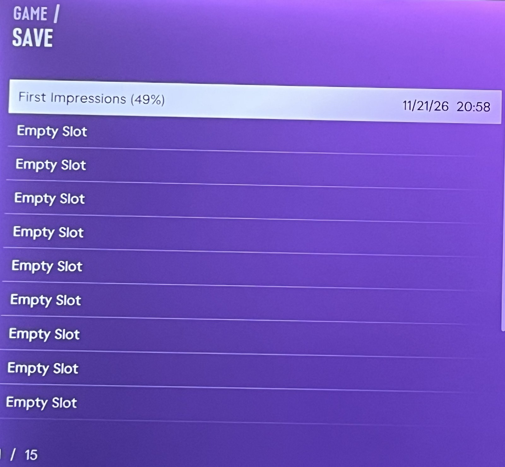

**To save in GTA 6, pause the game, go to Game, then Save Game, and pick a slot.** You don't need to find a bed or a safehouse. Here's how it all works.

> [!REPORTED]
> From guides by people playing the game (sources below). Older articles written before launch said beds save the game; players now say they don't.

## Manual save

1. Press **Options** to pause.
2. Go to **Game**, then **Save Game**.
3. Pick one of **15 save slots**.

On our own PS5 copy, the save screen sits under **Game → Save**. Each used slot shows your **progress percentage** and the **date and time** you saved, and the counter at the bottom reads **1 / 15**. Press **X** to overwrite a slot or **Square** to delete one.

You can save **almost anywhere**, as long as you're **not in a mission**. You also can't save during the game's opening section.

## Autosave

- The game **autosaves** to its own slot, which doesn't use up your 15 manual slots.
- It reportedly saves **after missions**.

## What doesn't save

- **Sleeping in a bed** doesn't save the game; it just **skips time** (and keeps your Sleep stat up: see the [pause menu guide](article:gta-6-pause-menu-stats-progress)).
- There's **no phone quick-save** like in GTA V, players report.

## Tips

- **Save before big jumps.** Use a fresh slot before you try something risky, so you can go back.
- One guide warns that loading a free-roam save may put you **back at your safehouse**, not exactly where you saved.
- If a save won't load, see [stuck on the loading screen](article:gta-6-stuck-on-loading-screen). Don't delete a save just because one load fails.
