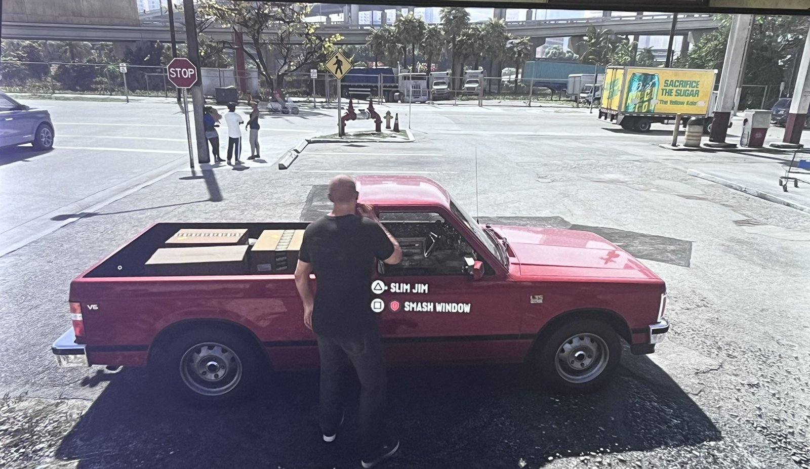
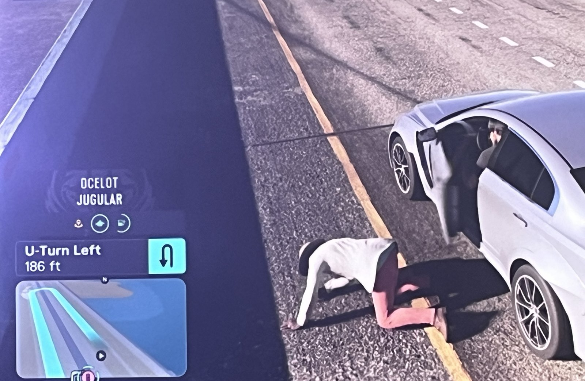
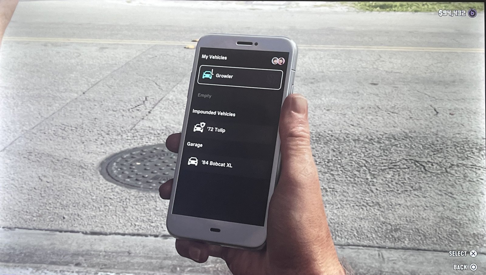

**Taking cars in GTA 6 isn't one button any more:** you scan them, deal with locks and alarms, and unlock new tools as you play. Here's how it works, with no story spoilers.

> [!CONFIRMED]
> The Slim Jim, the Chapter 3 key cloner and car values in Waink are from our own playthrough. The side jobs come from players' guides (sources below) and are labeled reported.

## Step 1: Scan the car with Waink

Point your phone at a parked car with the **Waink** app. The scan shows:

- **Access:** locked or unlocked
- **Security:** whether it has an **alarm**
- **Tracker:** whether it can be followed
- **Value:** what the car is worth

Full details: [Waink app guide](article:gta-6-waink-app-car-scanner).

## Step 2: Get in

| Car | What you need | When you get it |
| --- | --- | --- |
| Unlocked, no alarm | Nothing, just get in | From the start |
| Alarmed | **Slim Jim** | Unlocks as you progress the story |
| Locked / keyed cars | **Key cloner** | **Chapter 3** |

On our PS5 copy, walking up to a locked car gives two choices: **Triangle: Slim Jim** (quiet) or **Square: Smash Window** (fast, but loud).

**Tip:** an alarm going off draws attention, so watch your [wanted level](article:gta-6-wanted-level).

## Carjacking a car someone's driving

You can still take a car **with someone in it**: walk up to the driver's door and get in, and the driver gets **pulled out** onto the road. Ours was an **Ocelot Jugular**. It's loud, so expect witnesses and police.

## Car theft side jobs

Open the map's **Robberies** or **Vehicles** tab and look under **Drop-offs**: on our copy it lists two contacts who buy stolen cars, **Randy** and **Moses**. The job description reads that Moses "is after a few specific vehicles and will pay extra for them."

- Players report the **vehicle drop-offs** open in **Chapter 2**: you get a rough search area for a car, find it and deliver it.
- A **wish list** of cars to steal reportedly opens in **Chapter 3**.

## Keeping a car you take

Take it to a **Pay 'n' Spray** and choose **Register** to make it yours. Your phone's **My Vehicles** screen then lists your personal car, any **impounded** cars and cars in your **garage**:

See [garages](article:gta-6-garages-properties) and [car customization](article:gta-6-car-customization).

## Free cars worth taking

- A purple supercar with nitrous on Waxman Island: see [free supercar](article:gta-6-waxman-island-emerus).
- Upgrade what you take: [car customization](article:gta-6-car-customization).
