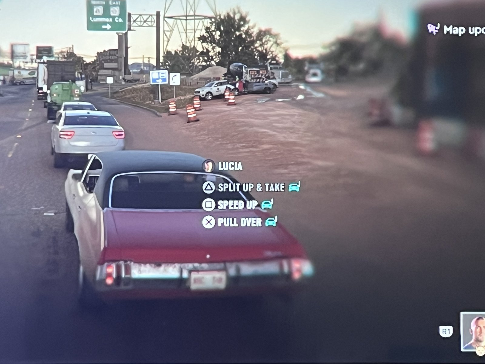

**To switch between Jason and Lucia, hold right on the D-pad and press R1 (PS5) or RB (Xbox).** You get a short transition, then you're playing as the other one. No story spoilers below.

> [!REPORTED]
> This comes from several gaming guides written by people playing the game (sources below). We'll confirm the exact steps on our own copy.

## How to switch

1. **Hold right** on the D-pad.
2. Press **R1** (PS5) or **RB** (Xbox).
3. After a short transition, you take control of the other character.

## When switching unlocks

- You **can't switch freely at the start**. The game decides who you play early on.
- Free switching **unlocks midway through Chapter 2**, as you progress the story (confirmed on our own playthrough).

## When you can't switch

- **Some missions lock you** to one character, and some story moments switch you automatically.
- A **darkened portrait** means your partner is busy right now. Try again a bit later.

## Interacting with your partner

To talk to or do things with your partner, **hold Right on the D-pad**. When they're driving, you get options like **Split Up & Take**, **Speed Up** and **Pull Over**:

See how your partnership affects things in [relationship levels](article:gta-6-relationship-levels).

## Tips

- Each character has their **own stats** (sleep, food, strength): see our [pause menu guide](article:gta-6-pause-menu-stats-progress).
- The default controls are in our [PS5 controls guide](article:gta-6-controls-ps5-xbox).
