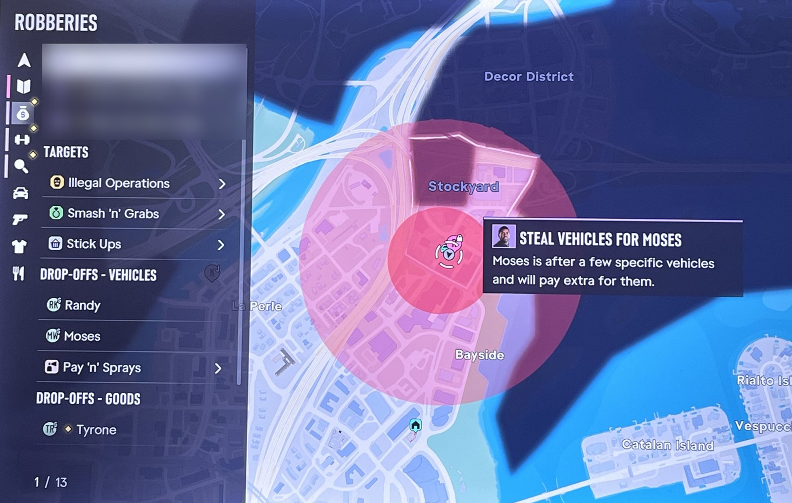

**Illegal Operations are gang hideouts you can raid for cash, and most have a safe.** Here's how they work and the codes players have reported, with no story spoilers.

> [!REPORTED]
> Where to find them on the map is from our own PS5 copy. The safe codes come from players' guides (sources below). They're widely repeated, but we haven't tried them all, so treat them as reported.

## Find them on the map

Open the map, pick the **Robberies** tab (money-bag icon), and under **Targets** choose **Illegal Operations**. These are operations run by gangs and common thieves, and taking from them pays.

Guides count about **39** of them across Leonida.

## Gang hideout safe codes (reported)

| Hideout | Code |
| --- | --- |
| Kingpin Bowling | **0300** |
| Brooks Boatworks | **6823** |
| La Cascara Motel | **6969** |
| Sunrise RV Park | **6769** |
| Nova Auto Junkyard | **7777** |
| Farm Fix Meth Lab | **2121** |
| Illegal Sneaker Trade | **4124** |

Other codes are floating around, but guides disagree on them, so we've left them out until they're confirmed.

## Tips

- **Store safes are different.** Codes for store and jewelry robbery safes are reportedly **random**, so look for a note nearby. **Focus (L3 + R3)** highlights clues.
- **Expect a fight.** Hideouts are guarded, so a [silenced pistol](article:gta-6-silenced-pistol-assassin-nipper) helps.
- **Bank the cash afterwards:** you lose what you carry if you die or get busted. See [beginner tips](article:gta-6-beginner-tips).
- More ways to earn: [robbing stores](article:gta-6-rob-stores-stick-ups), [Smash 'n' Grabs](article:gta-6-smash-n-grab) and [making money](article:gta-6-how-to-make-money).
