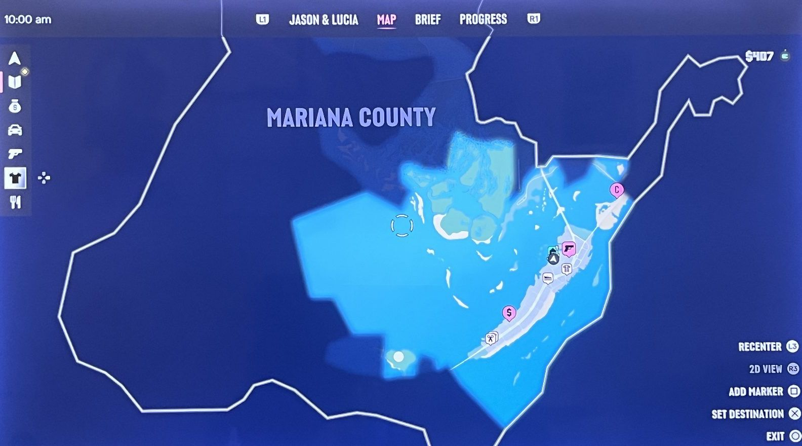
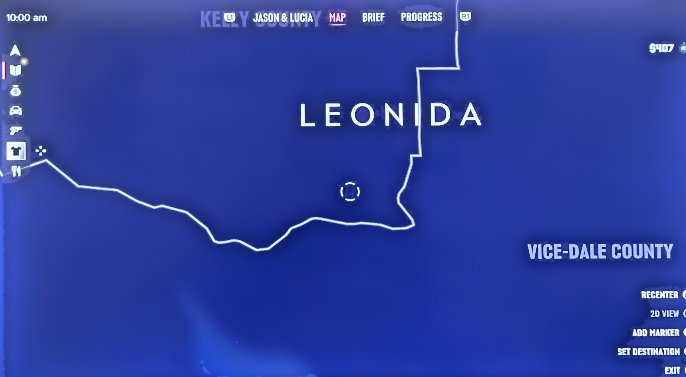
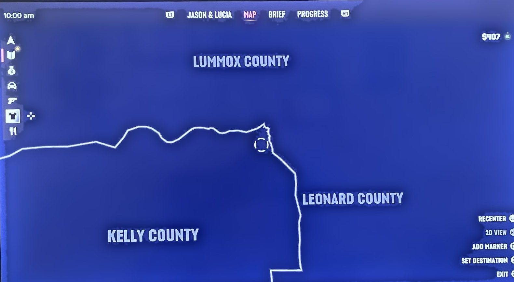

**GTA VI takes place in Leonida, a fictional US state Rockstar calls "the sunniest place in America," centered on Vice City.** Rockstar has officially named six regions so far: **Vice City, Leonida Keys, Grassrivers, Port Gellhorn, Ambrosia and Mount Kalaga.**

> [!CONFIRMED]
> Region names come from Rockstar's official "Only in Leonida" page, checked November 15, 2026. Rockstar invites visitors to "tour a few of the must-see destinations across the sunshine state."

## The six official regions

{{regions}}

| Region | What Rockstar says about it (our summary) |
| --- | --- |
| **Vice City** | "The glamour, hustle, and greed of America captured in a single city." Neighborhoods named so far: **Ocean Beach** (pastel art deco hotels, white sand), **Little Cuba** (panaderías), the **Tisha-Wocka flea market**, and **VC Port**, called "the cruise ship capital of the world." |
| **Leonida Keys** | A "tropical archipelago" where life "isn't flashy but it's easy," next to "some of the most beautiful and dangerous waters in all of America." Jason lives and works here. |
| **Grassrivers** | A "primordial expanse" of mangroves. Gators are the famous attraction, but Rockstar hints at "far deadlier predators and weirder discoveries." |
| **Port Gellhorn** | A faded vacation town of cheap motels, shut-down attractions and empty strip malls, with "a new economy" fuelled by "malt liquor, painkillers, and truck stop energy drinks." |
| **Ambrosia** | "In the heart of Leonida": an industrial town where the **Allied Crystal** sugar refinery provides the jobs and "the local biker gang provides almost everything else." |
| **Mount Kalaga** | "A national landmark up against the state's northern border," with hunting, fishing and off-road trails in **Mount Kalaga National Park**, and backwoods home to "hillbilly mystics and paranoid radicals." |

## Counties on the in-game map

The in-game map (pause menu → Map) divides **Leonida** into named **counties**. So far we've seen:

- **Mariana County**
- **Vice-Dale County**
- **Kelly County**
- **Lummox County**
- **Leonard County**

### The full map, zoomed out

Zoom all the way out and the map shows the whole state of **Leonida**, split into counties by white border lines. Early in the game, most of it is still unexplored. These are our own screenshots from launch day:

> [!CONFIRMED]
> Seen on the in-game map on our own PS5 copy, launch day (November 19, 2026). The game doesn't say which of Rockstar's six regions sits in which county, so we're not matching them up yet. More of the map unlocks as you play; we'll add counties as we find them.

Map controls: **L3** recenter, **R3** 2D view, **Square** add marker, **X** set destination. See the [pause menu guide](article:gta-6-pause-menu-stats-progress).

## Other official place names

- **Leonida Penitentiary:** where Lucia served time, per her official profile.
- **Southside Vice City:** an official edition-item description invites you to "raid the compound of one of Southside Vice City's loudest and most socially active gangs."
- **Watson Bay:** home of the "Paradise Garage," per an official edition-item description (a garage with a weapon locker and a place to stash stolen goods to be fenced).
- **Liberty City:** mentioned in Lucia's background (her mother's dream of a better life goes back to "their days in Liberty City"). That doesn't mean it's playable.

> [!UNCONFIRMED]
> Map size, a full region list, and comparisons with GTA V's map are not officially confirmed. Maps circulating online are fan-made from trailers or leaked material.

## What's coming to this section after launch

- An interactive region guide with points of interest.
- Safehouse and property locations.
- Where to find shops, mod garages and services, including the Ultimate Edition locations named by Rockstar (see [editions](article:gta-6-editions-standard-vs-ultimate)).
