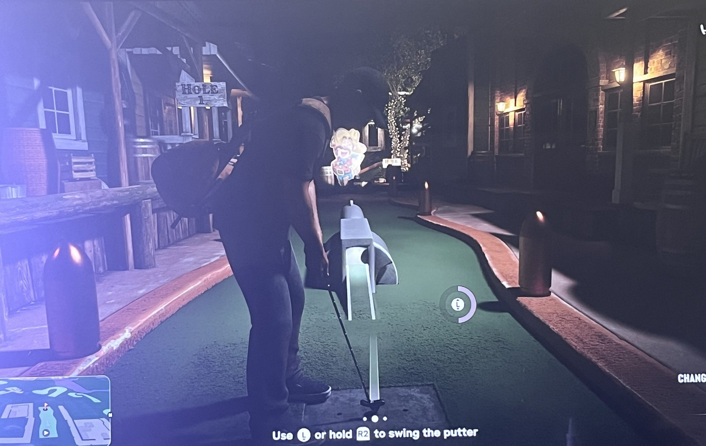

**GTA 6 has three mini golf courses, and one of them is free.** Here's where they are and how to play, with no story spoilers.

> [!REPORTED]
> From guides and maps made by people playing the game (sources below). We haven't played a round ourselves yet.

## All 3 mini golf courses

| Course | Where | Cost |
| --- | --- | --- |
| **King Gator Adventure Golf** | Buckskin Swamp, Vice-Dale County | Pay at the gate |
| **Frontier Adventure Golf** | Waning Sands, Leonard County | Pay at the gate |
| **Dino Golf Challenge** | Frogswater, Kelly County | **Free** (an abandoned course) |

Players say all of them are open **from the start**. Frontier is the Wild West-themed course players have been sharing clips from. See where the counties are in our [map guide](article:gta-6-map-leonida-regions).

## Our round at Frontier (PS5)

We played **Frontier Adventure Golf**, the **Wild West** course, at night. To putt, the game says: "**Use the left stick or hold R2 to swing the putter.**" 

## How to play

1. At King Gator or Frontier, walk up to the **attendant at the gate** and pay for a club and ball.
2. Pick **18 holes**, the **front nine** or the **back nine**.
3. On each hole, choose one of **three starting spots** for your ball.
4. Aim, then swing with the **left stick** or **hold R2** (RT on Xbox) to putt.

## 100% completion and challenges

- Guides say you need to play **2 of the 3** mini golf courses for 100%. Pick any two.
- A reported **Golf Pro** challenge asks you to play 18 holes at **both King Gator and Frontier in one day**, at par or better.

## Full-size golf

GTA 6 also reportedly has **2 full 18-hole golf courses**, but they don't count toward the 100% checklist. For more things to do, see [activities](article:gta-6-activities-pool-basketball-gym) and [fishing](article:gta-6-fishing).
