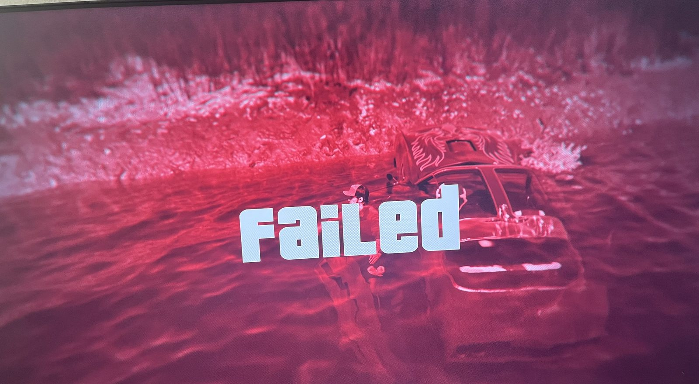

**When you fail a mission in GTA 6, the screen turns red and big white "Failed" text appears**, frozen on the moment things went wrong.

## What the screen looks like

- The whole picture turns **red**.
- **"Failed"** appears in big white letters in the middle.
- In ours, the car had ended up **in the water**, which is a quick way to fail a mission.

> [!UNCONFIRMED]
> We haven't confirmed yet what comes after the Failed screen (for example, whether you can retry from a checkpoint or skip a section after failing several times). We'll update this page once we've checked.

## Tips to avoid failing

- **Keep your car out of the water.** Cars that end up in deep water are usually done for.
- **Watch your wanted level.** See [GTA 6 wanted level and HUD](article:gta-6-wanted-level).
- **Check your settings.** Accessible Combat and Reduced Vehicle Damage can make missions easier; see our [settings guide](article:gta-6-best-settings).
