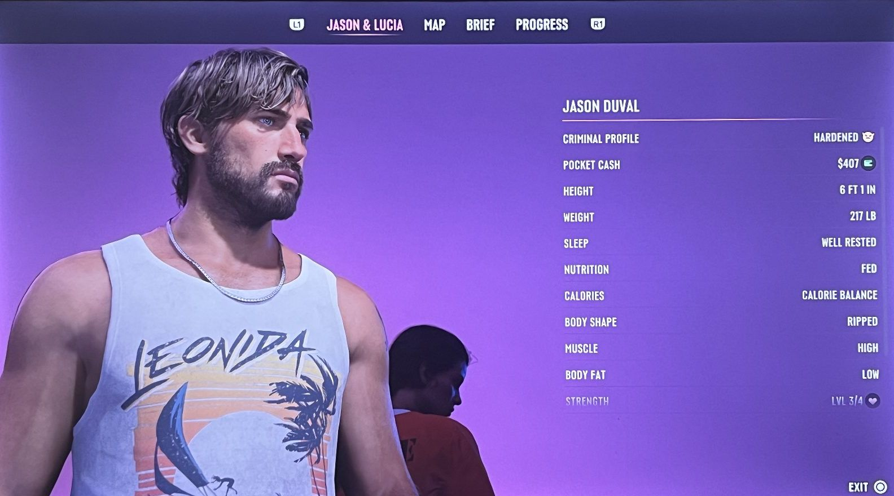
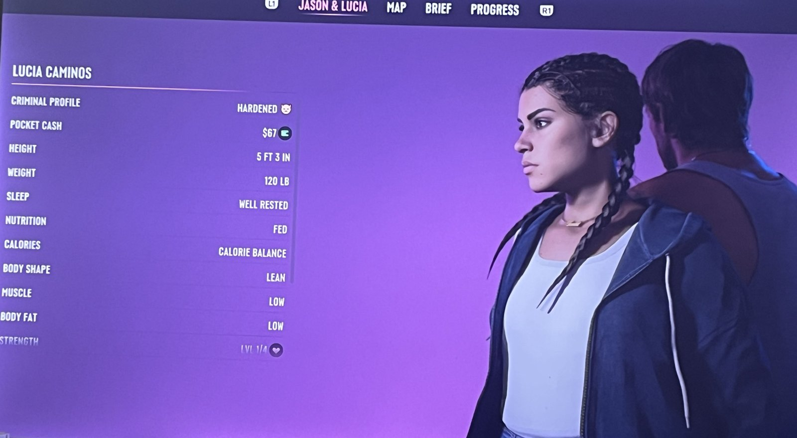
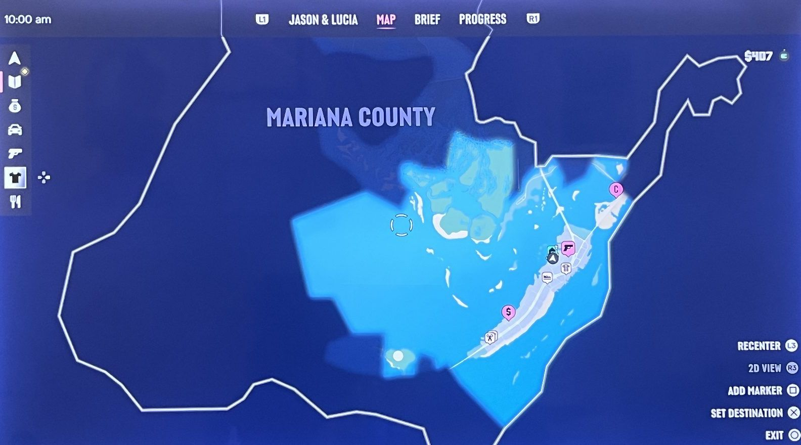
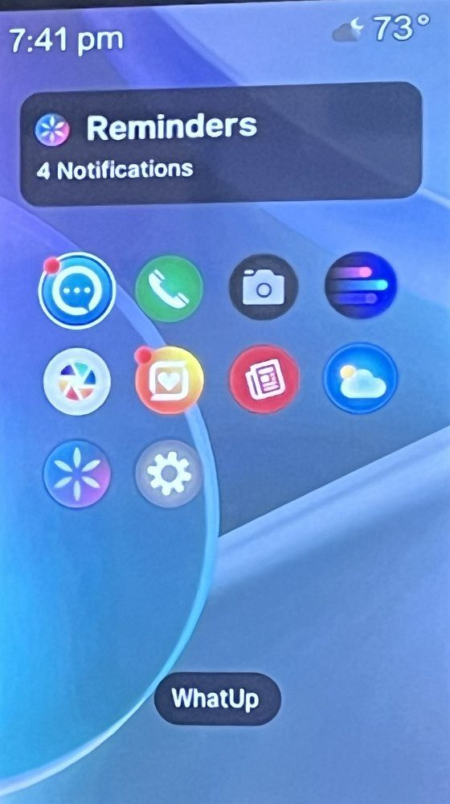
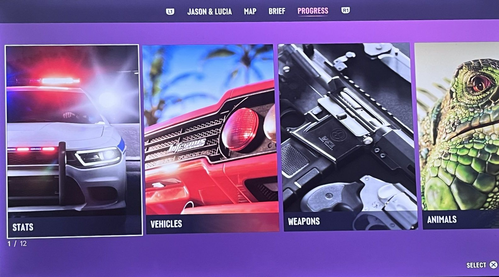
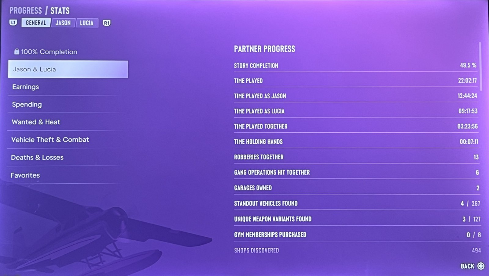

**GTA VI's pause menu has four tabs: Jason & Lucia, Map, Brief and Progress.** Switch between them with **L1** and **R1**. The surprise is the character screen: it tracks **sleep, food, calories, muscle, body fat and strength**, like a fitness tracker for your criminal.

> [!CONFIRMED]
> Everything here comes from the pause menu on our own PS5 copy, photographed on launch day (November 19, 2026). Values are what our save showed early in the game.

## Jason & Lucia: character stats

The first tab shows the character you're playing and their stats. This is what our Jason Duval showed:

| Stat | Ours showed |
| --- | --- |
| Criminal Profile | Hardened |
| Pocket Cash | $407 |
| Height | 6 ft 1 in |
| Weight | 217 lb |
| Sleep | Well Rested |
| Nutrition | Fed |
| Calories | Calorie Balance |
| Body Shape | Ripped |
| Muscle | High |
| Body Fat | Low |
| Strength | Level 3 of 4 |

What this tells you, without guessing at the exact rules:

- **Sleep and food matter enough to be tracked.** Expect your character's state to change if you skip them.
- **Body shape is tracked separately from strength.** Muscle and body fat sit alongside a Strength level that goes up to 4.
- **Criminal Profile** is a rating ("Hardened" on ours). The UI settings also let you turn Criminal Profile notifications on or off.

### Lucia's stats

Switch to Lucia on the same tab to see hers. Our Lucia Caminos showed:

| Stat | Ours showed |
| --- | --- |
| Criminal Profile | Hardened |
| Pocket Cash | $67 |
| Height | 5 ft 3 in |
| Weight | 120 lb |
| Sleep | Well Rested |
| Nutrition | Fed |
| Calories | Calorie Balance |
| Body Shape | Lean |
| Muscle | Low |
| Body Fat | Low |
| Strength | Level 1 of 4 |

Each character has **their own stats and their own pocket cash**, so Lucia started out much weaker than our Jason (Strength 1 vs 3).

**Relationship level:** the main Jason & Lucia screen also shows the couple's relationship level (ours: **Hot Together, 4/4**), your bank balance and your cash. See [relationship levels](article:gta-6-relationship-levels).

We'll explain how each stat changes once we've tested it.

## Map

- **Counties:** the map is divided into named counties. So far we've seen **Mariana, Vice-Dale, Kelly, Lummox and Leonard** counties. See our [GTA 6 map guide](article:gta-6-map-leonida-regions).
- **Filters (left side):** icons for navigation, the map, money, vehicles, weapons, clothing and food, with a D-pad icon beside them.
- **Controls:** **L3** recenter, **R3** 2D view, **Square** add marker, **X** set destination, **Circle** exit.
- The top corners show the **time of day** and your **cash**.

## Brief

The Brief tab sits between Map and Progress. We'll add what it shows once we've captured it.

## Bonus: your in-game phone

The phone isn't part of the pause menu, but it's where a lot of your day-to-day happens:

- A **Reminders** widget at the top (ours had 4 notifications); press **Square** to open reminders.
- **10 app icons**, including ones that look like messages, phone, camera, photos, news, weather and settings. Red dots mark apps with something new.
- The selected app's name shows at the bottom: ours was **WhatUp**, the chat-bubble app.
- The time and weather sit at the top (ours: 7:41 pm, 73°).

## Progress: 12 categories

The Progress tab has **12 categories**:

1. Stats
2. Vehicles
3. Weapons
4. Animals
5. Equipment
6. Collections
7. Activities
8. Contacts
9. Gangs
10. Robberies
11. Challenges
12. Story Recap

**Equipment** (shown with binoculars), **Animals** and **Collections** suggest there's plenty to find and log around Leonida. **Story Recap** is the place to catch up if you take a break from the story.

## Progress → Stats

The **Stats** category has **General, Jason** and **Lucia** tabs. General's sections are **100% Completion** (locked until you finish), **Jason & Lucia, Earnings, Spending, Wanted & Heat, Vehicle Theft & Combat, Deaths & Losses** and **Favorites**. Partner Progress tracks things like **story completion**, **time played** (each character and together), **time holding hands**, **robberies together**, **garages owned**, **standout vehicles found** (of 267), **unique weapon variants** (of 127), **gym memberships** (of 8) and **shops discovered**.
