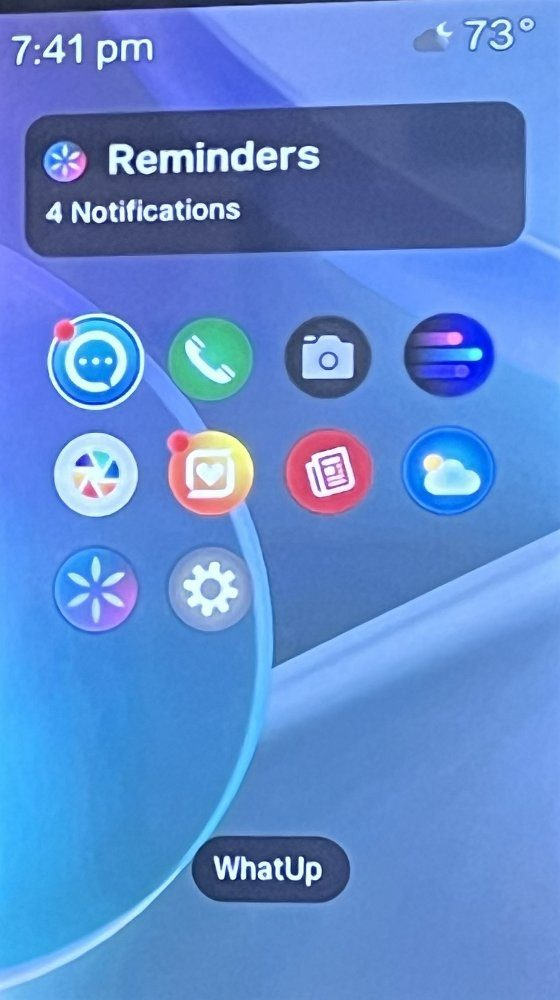

**Your phone does a lot in GTA 6:** banking, rides, scanning cars and more. Here's what each app does, with no story spoilers.

> [!REPORTED]
> The home screen and Waink are from our own PS5 copy. What each app does comes from players' guides (sources below). Rockstar hasn't published a full app list.

Open the phone with **Up on the D-pad**. Red dots mark apps with something new.

## The apps

| App | What it does |
| --- | --- |
| **Waink** | Scans a parked car: locks, alarm, tracker and value. See our [Waink guide](article:gta-6-waink-app-car-scanner). |
| **RydeMe** | Calls a ride and lets you pay to skip the trip. See [fast travel](article:gta-6-fast-travel). |
| **BuckMe** | Your **bank**. Money here reportedly survives dying or getting busted; pocket cash doesn't. |
| **WhatUp** | Messages and chats. |
| **Scooter Bros** | Brings a **car you own** to your location (may cost a fee). |
| **Snapmatic** | A social feed to browse and follow accounts. |
| **Camera / Gallery** | Photos and **selfies**, and where they're stored. For posed shots, try [Photo Studio](article:gta-6-photo-studio). |
| **Contacts** | People you've met. Taxis are called from here. |
| **Fitness** | Tracks your character's fitness, food and sleep, guides say. |
| **Settings** | Wallpaper and ringtone. |

Some apps **unlock as you progress the story**, so your phone fills up over time.

## Tips

- **Bank your cash with BuckMe** after big jobs. See [beginner tips](article:gta-6-beginner-tips).
- Using the phone while driving: [phone while driving](article:gta-6-phone-while-driving).
