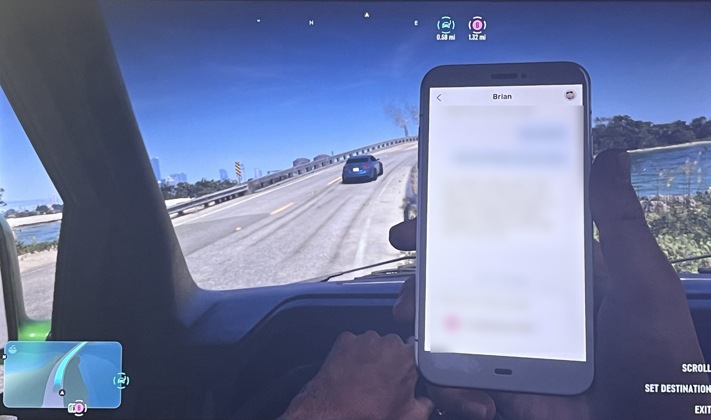

**Yes: in GTA 6 you can use your phone while you drive.** The phone pops up on one side of the screen, you can still see the road through the windshield, and the car keeps going under your control.

*Message text blurred to avoid story spoilers.*

## What you can do while driving

- **Read and scroll texts** without stopping.
- **Set a destination** straight from a message that includes a place. It shows up on your minimap and compass with the distance.
- **Keep steering.** The road stays visible behind the phone, so you can watch traffic.

The on-screen prompts while the phone is open: **Scroll**, **Set Destination** and **Exit**.

## Tips

- **It works in first-person driving too**, as in our screenshot.
- **Watch the road.** You're still driving, so a quick glance is safer than reading long threads at speed.
- More about the phone: see our [pause menu guide](article:gta-6-pause-menu-stats-progress) and the [Waink car-scanning app](article:gta-6-waink-app-car-scanner).
