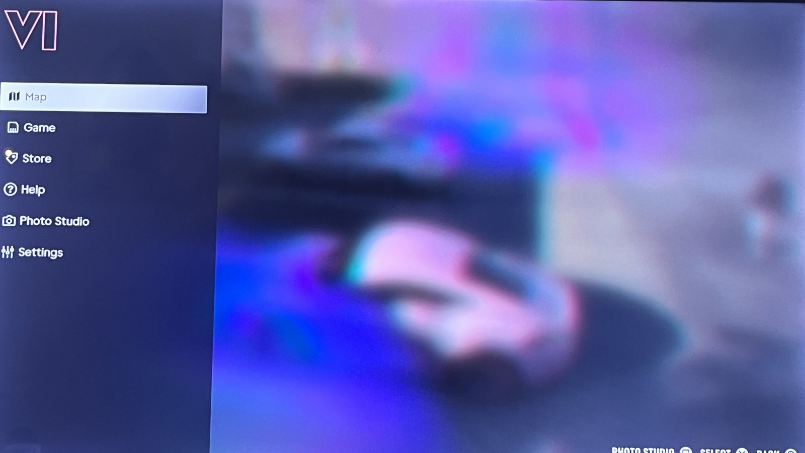
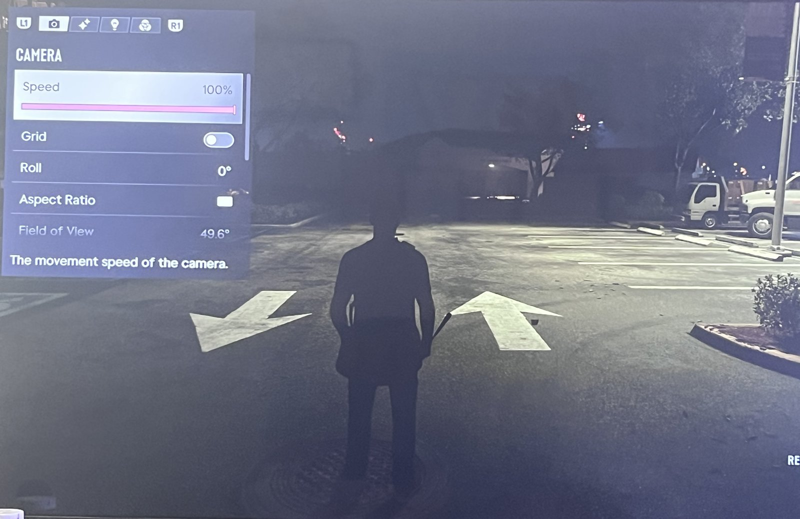
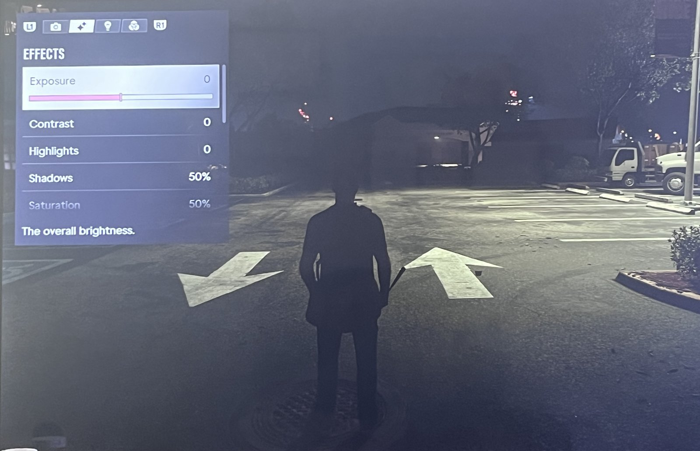
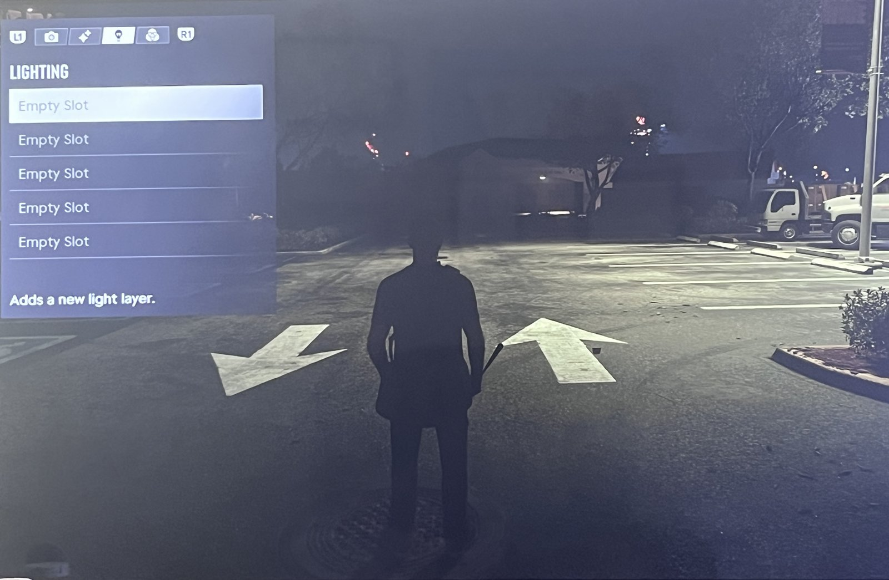
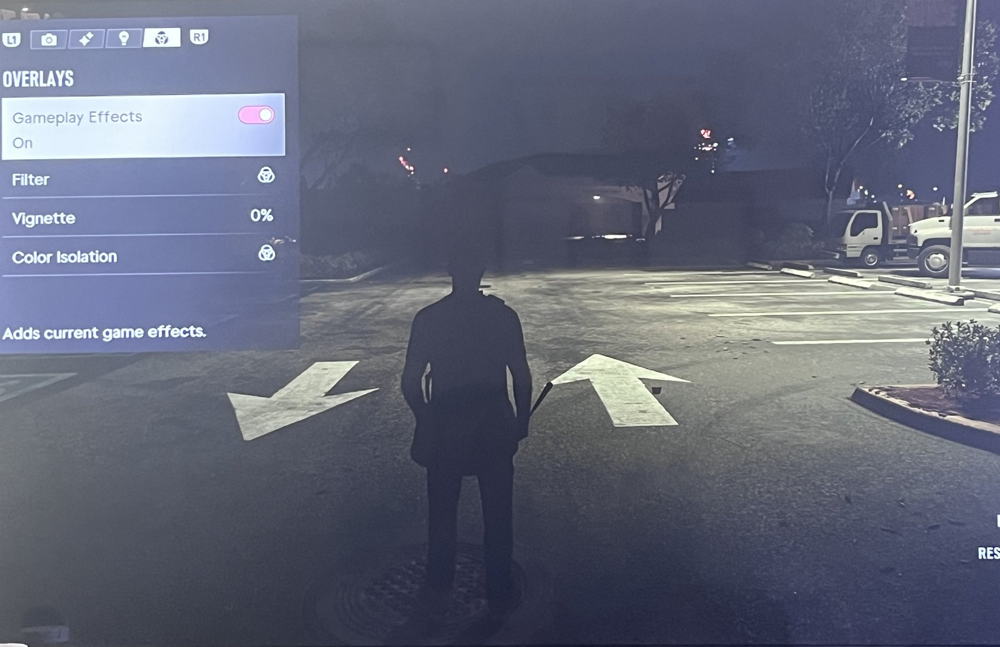

**GTA 6's photo mode is called Photo Studio, and it's right in the pause menu.** Here's how to open it and what the options do.

> [!CONFIRMED]
> The Photo Studio menu option and its Square shortcut are from the pause menu on our own PS5 copy. The four tabs inside it are from our own copy too; saving tips come from players' guides (sources below).

## How to open Photo Studio

1. Press **Options** (Menu on Xbox) to pause.
2. Pick **Photo Studio**: it sits between **Help** and **Settings**.
3. Shortcut: on our pause screen, **Square** opens Photo Studio directly (X on Xbox, players say).

Some options can show as unavailable during cutscenes, guides report.

## The 4 Photo Studio tabs (our PS5)

Switch tabs with **L1 / R1**. Each option shows a short description at the bottom of the panel.

### 1. Camera

**Speed** (how fast the camera moves), **Grid** (on/off guide lines), **Roll** (tilt), **Aspect Ratio** and **Field of View**.

### 2. Effects

**Exposure** ("the overall brightness"), **Contrast**, **Highlights**, **Shadows** and **Saturation**, plus more if you scroll.

### 3. Lighting

Five **light slots**: each one "adds a new light layer", so you can light up a dark scene.

### 4. Overlays

**Gameplay Effects** (keeps the game's own effects on), **Filter**, **Vignette** and **Color Isolation** (keep one color, fade the rest).

## Saving your photo

- Choose **Save Photo**. Guides say pictures go to your **console's capture gallery**.
- If you see a "Couldn't Save" error, players suggest **hiding the interface** and using your console's own screenshot button.

## Selfies and poses

Photo Studio reportedly has **no pose menu**. For selfies and poses, open the **Camera app** on the in-game phone, which guides say becomes available early in the game.
