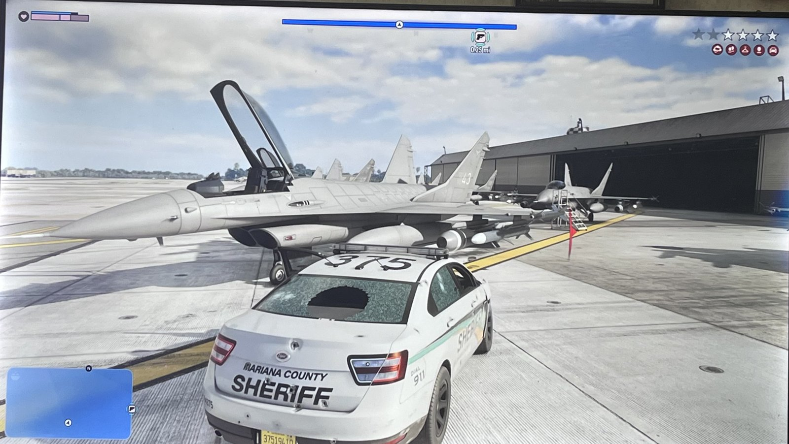

**Yes, you can fly in GTA 6, and you don't need a license.** Here's where to find aircraft, with no story spoilers.

> [!REPORTED]
> Stealing a fighter jet is from our own play. Other aircraft spots come from players' guides (sources below), and parked aircraft don't always spawn in the same place.

## Do you need a pilot license?

Players report **no flight school and no license**. You get your first taste of flying **as you progress the story**, early on.

## Where to find aircraft (reported)

| Aircraft | Where |
| --- | --- |
| **Helicopter** | The **Southwind dock** in the Keys |
| **Small planes and seaplanes** | Airfields and docks around Leonida |
| **Passenger jets** | **Vice City International Airport** (restricted: expect guards and police) |
| **Fighter jets** | **Mile Zero Air Station**: see our [fighter jet guide](article:gta-6-steal-fighter-jet) |

## Tips

- **Restricted areas** (the airport and the air base) bring a big [wanted level](article:gta-6-wanted-level) fast.
- Aircraft controls are in **Settings → Control Scheme → Aircraft**: see [controls](article:gta-6-controls-ps5-xbox).
- Prefer the water? See [boats and jet skis](article:gta-6-boats-jet-skis).
