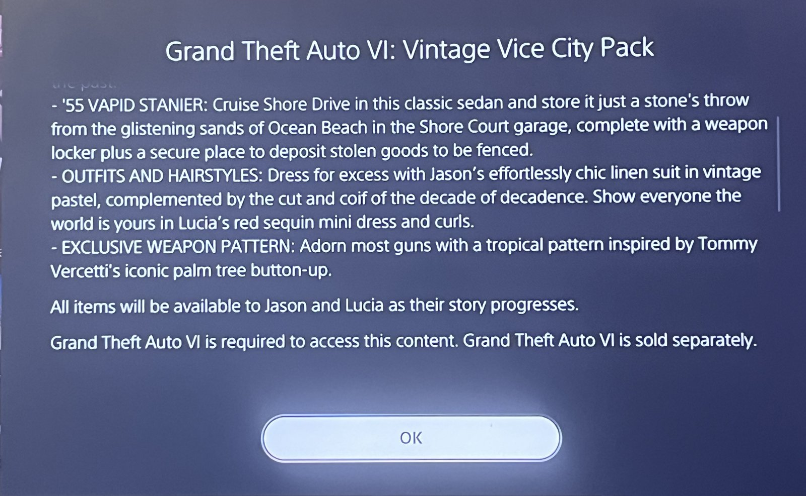

> [!CONFIRMED]
> **Update, November 20, 2026:** the free offer has ended. Rockstar's site now lists the Vintage Vice City Pack as a **"Digital Add-On"** ("Purchase this add-on to get unique benefits that flash back to when the neon burned brightest"), and the Rockstar Store no longer shows "Order before Nov. 20". The store describes the pack as the two-tone '55 Vapid Stanier sedan and garage, decadent outfits and hairstyles for both Jason and Lucia, and an iconic weapon pattern.

**The GTA VI pre-order bonus is the Vintage Vice City Pack.** Now the game is out, Rockstar calls it an **Early Purchase Bonus**: buy **before November 20, 2026** to get it. Rockstar describes it as "unique benefits that flash back to when the neon burned brightest."

> [!CONFIRMED]
> The Rockstar Store says: "Order before November 20 to get the Vintage Vice City Pack at no additional cost." The offer carries an asterisk whose note reads "While supplies last." The page doesn't say exactly which orders that applies to.

## What's in the Vintage Vice City Pack?

Item names as listed on the Rockstar Store:

- **'55 Vapid Stanier Sedan and Garage**
- **Outfits and Hairstyles**
- **Exclusive Weapon Pattern**

Plus, listed separately as a **Digital Store Early Purchase Bonus** (it was called a Pre-Order Bonus before launch):

- **Free Month of GTA+**

### What each item actually is

The pack's description on the **PlayStation Store** spells it out:

| Item | What you get |
| --- | --- |
| **'55 Vapid Stanier** | A classic sedan, plus the **Shore Court garage** near **Ocean Beach**. The garage has a **weapon locker** and a secure spot to **stash stolen goods** to be fenced. |
| **Outfits and hairstyles** | A **vintage pastel linen suit** and a retro haircut for **Jason**; a **red sequin mini dress** and curls for **Lucia**. |
| **Exclusive weapon pattern** | A **tropical palm-tree pattern** you can put on most guns, inspired by **Tommy Vercetti's** shirt from GTA Vice City. |

**When you get them:** the store says all items "will be available to Jason and Lucia **as their story progresses**", so they don't all show up on day one.

## Who qualifies?

| How you buy | Vintage Vice City Pack | Free month of GTA+ |
| --- | --- | --- |
| Digital, PlayStation Store or Microsoft Store, before Nov 20 | Yes | Yes |
| Physical code-in-box from the Rockstar Store, before Nov 20 | Yes (subject to the "while supplies last" note) | Not listed as included* |
| After November 19 (Nov 20 onwards) | No | No |

\*Rockstar's GTA+ FAQ talks only about pre-orders from the **PlayStation Store or Microsoft Store**. If you bought a physical copy elsewhere, check the retailer's listing for which bonuses it includes.

## Deadline in plain terms

"Before November 20" means **launch day (November 19) still counts**. If you're buying on launch night, you're still in time.

## How do I get the bonus items in the game?

The PlayStation Store listing says the items "will be available to Jason and Lucia **as their story progresses**." So keep playing: they unlock along the way rather than all at once. You need the base game to use them.

## How to redeem the free GTA+ month

Rockstar's redemption steps differ by platform, and so do the deadlines (PS5: by **March 31, 2027**; Xbox: within **180 days** of purchase). See [how to redeem the free month of GTA+](article:gta-6-free-month-gta-plus-redeem).
