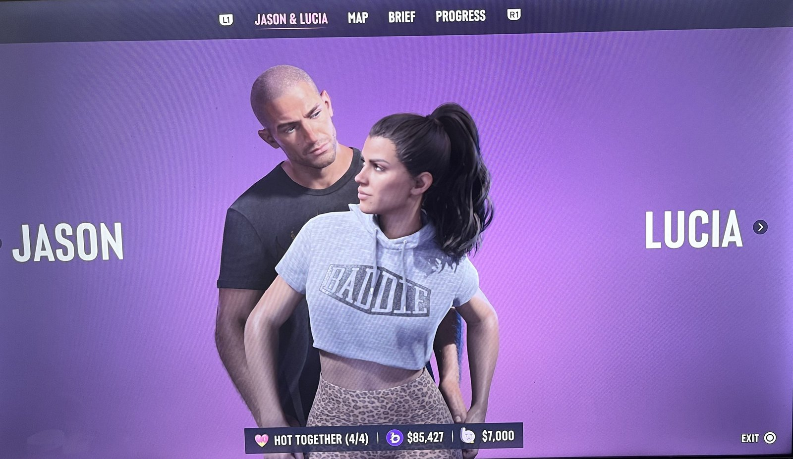
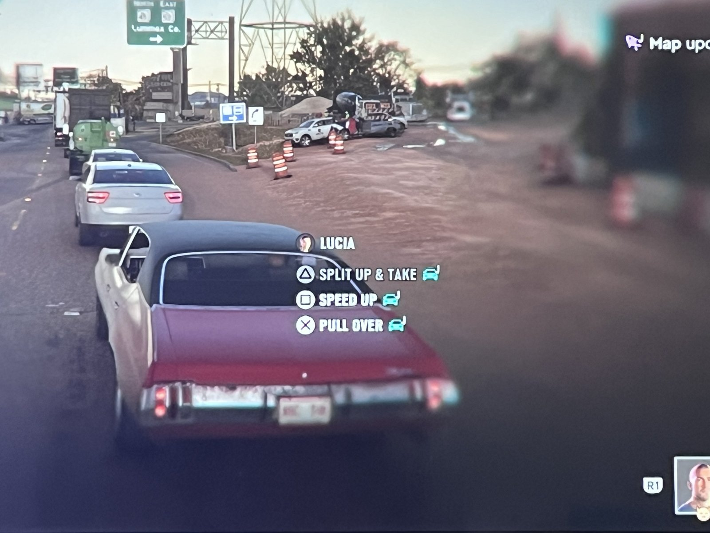

**Jason and Lucia have a relationship meter with 4 levels, and the top one is Hot Together.** Here's how it works, with no story spoilers.

> [!CONFIRMED]
> The Hot Together level and the partner menu are from our own PS5 copy. How the meter rises and falls comes from players' guides (sources below) and is labeled reported.

## Where to see it

Open the pause menu: the **Jason & Lucia** tab shows the relationship level at the bottom. Ours said **Hot Together (4/4)**, next to the bank balance and cash.

## The 4 levels (reported)

| Level | Name |
| --- | --- |
| 1/4 | Running on Empty |
| 2/4 | Partners in Crime (some guides say "Not So Hot") |
| 3/4 | Crazy in Love |
| 4/4 | **Hot Together** |

Guides disagree on the name of level 2, so go by the number.

## How to raise it (reported)

- **Spend time together:** hang out at home, sit on the couch together, and go to bed at the same time.
- **Go out together:** players say activities and trips as a pair help.
- **Work together:** jobs and escaping the police as a team reportedly count too.
- **Both have to put in effort:** one guide says you won't reach Hot Together if only one of them does the work.

## How it drops

Players report the meter can **slip** if you keep **turning down** invitations to hang out or go to bed together at home.

## The partner menu

When your partner is driving, a menu with their name pops up. Ours showed:

- **Triangle:** Split Up & Take (a car)
- **Square:** Speed Up
- **X:** Pull Over

To talk to or interact with your partner, **hold Left on the D-pad**. For switching who you play as, see [switching characters](article:gta-6-how-to-switch-characters).
