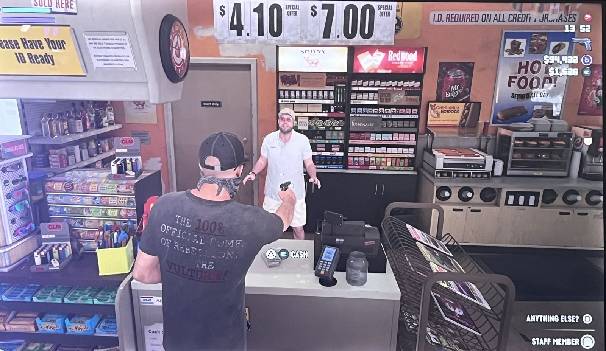

**You can rob stores in GTA 6 once stick-ups unlock in Chapter 2,** and it's not just convenience stores: jewelry stores and even gun stores are fair game. Here's how, with no story spoilers.

> [!CONFIRMED]
> When stick-ups unlock and which stores you can rob are from our own playthrough. Steps, safes and payouts come from players' guides (sources below) and are labeled reported.

## When stick-ups unlock

**Chapter 2**, as you progress the story. Some bigger store jobs open up later on.

## Stores you can rob

- **Convenience stores**
- **Jewelry stores** (guides list about 35)
- **Gun stores**
- **Regular shops**, plus liquor stores, fast-food places and pawn shops, guides say

## Find robberies on the map

Open the map and pick the **Robberies** tab (the money-bag icon). On our PS5 copy it lists every illegal way to make money:

- **Targets:** **Illegal Operations** (taking from gangs and common thieves), **Smash 'n' Grabs** and **Stick Ups**.
- **Drop-offs, vehicles:** contacts who pay for **stolen cars**, plus **Pay 'n' Sprays**.
- **Drop-offs, goods:** a contact who takes stolen goods.

Pick any entry to see the nearest ones on the map.

## A stick-up on our PS5

Aim at the cashier and the prompts appear: **Triangle: Cash** to take the register money, and **Square: "Anything else?"** to push for more.

## How a stick-up works (reported)

1. Walk in and **aim at the cashier** (L2).
2. Keep your aim on them while they **empty the register**.
3. Look for a **safe**: some stores have one, and notes nearby can give the code (use Focus, **L3 + R3**).
4. **Get out fast** and lose the police.

## Tips

- **Bank your cash** after a robbery: you lose the cash you carry if you die or get busted. See [beginner tips](article:gta-6-beginner-tips).
- A **silenced pistol** makes it less likely the cops come running: get one free early with our [Assassin Nipper guide](article:gta-6-silenced-pistol-assassin-nipper).
- Escaping: [wanted level guide](article:gta-6-wanted-level). More money ideas: [how to make money](article:gta-6-how-to-make-money).
