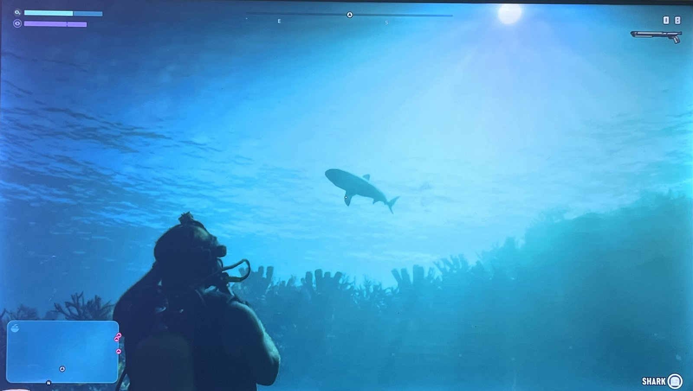

**You can't buy scuba gear in GTA 6, but once it unlocks you can grab it from boats.** Here's how, with no story spoilers.

> [!REPORTED]
> From guides by people playing the game (sources below). We'll confirm the controls on our own copy.

## Unlocking scuba gear

There's **no dive shop**. Scuba gear **unlocks in Chapter 1** as you progress the story, in the Keys.

## Putting it on

1. Get on a **boat that carries scuba gear**. Players point to the boat at the **dock behind Jason's house** in Key Lento.
2. Walk to the **back (stern)** of the boat.
3. Press **Triangle** (PS5) or **Y** (Xbox) to equip it.

Some guides say spare gear also turns up **on docks** around the Keys.

## Dive controls

| Action | PS5 | Xbox |
| --- | --- | --- |
| Dive | Hold **R1** | Hold **RB** |
| Surface | **X** | **A** |

## Underwater on our PS5

Watch the **oxygen bar** (top left) while you dive. And yes, there are **sharks**.

## Good to know

- **It disappears on land:** walk on solid ground for a bit and the gear despawns, players report. Re-equip from a boat out on the water.
- **Things to find down there:** shipwrecks, players say, and the giant [kraken easter egg](article:gta-6-kraken).
- Prefer staying dry? Try [fishing](article:gta-6-fishing).
