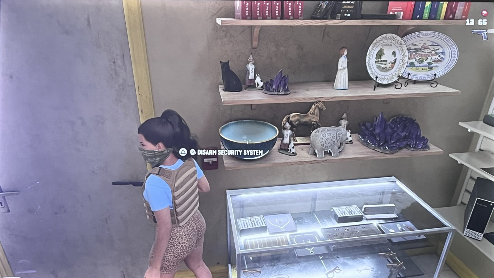
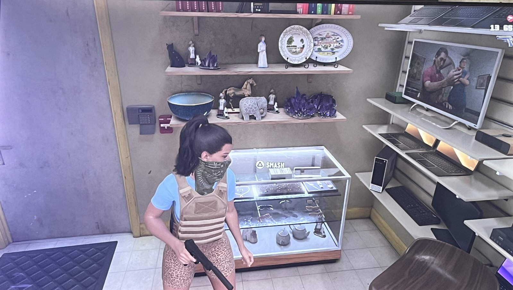

**Smash 'n' Grabs are quick store robberies where you smash the display cases and run,** and there are 35 of them. Here's how they work, with no story spoilers.

> [!REPORTED]
> The map listing is from our own PS5 copy. Counts, payouts and unlock points come from players' guides (sources below).

## Find them on the map

On the map's **Robberies** tab, under **Targets**, pick **Smash 'n' Grabs** to see the nearest ones.

## Pawn shops vs jewelry stores (reported)

| Type | How many | Payout | When |
| --- | --- | --- | --- |
| **Pawn shops** | 15 | Mostly about $4,500–$12,000 | **Chapter 2** |
| **Jewelry stores** | 20 | Up to about $25,000 | Later, as you progress the story |

Most pawn shops are in **Vice-Dale County** (11), with 3 in Kelly County and 1 in Mariana County, guides say. A few sit close together, so you can hit several in one trip.

## How to do one

1. **Disarm the security system** first: on our copy there's a panel on the wall (**Triangle: Disarm Security System**).
2. Walk up to a case and **smash** it (**Triangle: Smash**).

3. Keep going until the cases are empty.
4. Head to the **back room** and open the **safe**. Codes are reportedly **random**, so look for a note (use **Focus, L3 + R3**).
5. **Get out** and lose the police: see [wanted level](article:gta-6-wanted-level).

Players say a Smash 'n' Grab only counts as **complete** once you've looted the **safe**, not just the cases.

## Related

- Quick register robberies: [stick-ups](article:gta-6-rob-stores-stick-ups).
- Gang hideouts and fixed safe codes: [Illegal Operations](article:gta-6-illegal-operations-safe-codes).
