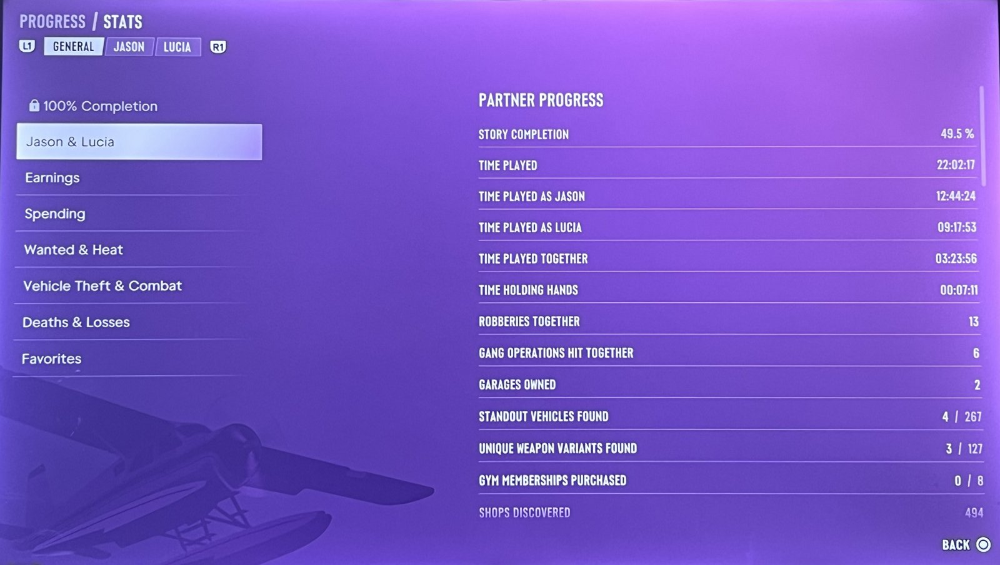

**Standout vehicles are GTA 6's rare cars:** special one-off versions of normal models. Here's how to find them, with no story spoilers.

> [!REPORTED]
> The count of 267 is from our own PS5 stats page. What standouts are and where they show up comes from players' guides (sources below), which give different totals.

## What a standout is

A **standout** is a rare version of an ordinary car or bike, with its **own livery, parts or stats**. They're worth more than a regular version and make great cars to keep.

## How many there are

Our **Progress → Stats** page tracks **Standout Vehicles Found**: ours was **4 / 267**. Guides online quote other numbers, but **267** is what the game itself shows.

## How to find them (reported)

- Check **driveways, parking lots and open garages**: many sit at **fixed spots**.
- Some drive around in **traffic**, so keep an eye on the road.
- **Scan** any car that looks special with the **Waink** app: see the [Waink guide](article:gta-6-waink-app-car-scanner).
- Your found standouts are listed under **Progress → Vehicles**.

## Keep it

Take it to a **Pay 'n' Spray** and choose **Register** to make it yours, then [customize it](article:gta-6-car-customization). How to get into locked ones: [how to steal cars](article:gta-6-how-to-steal-cars).
