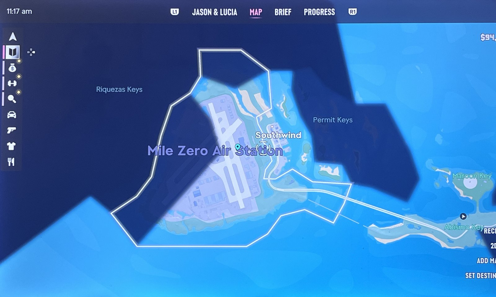
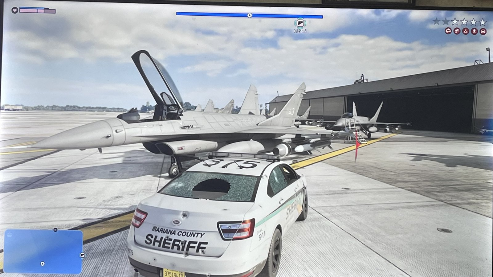
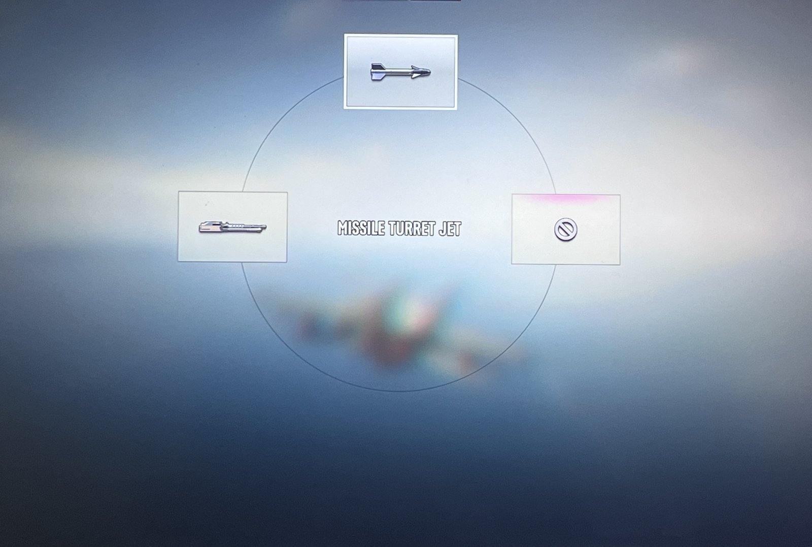

**Yes, you can steal a fighter jet in GTA 6,** and we did it on our own PS5. Here's where the base is, how to get in and what the jet can do. No story spoilers.

{{ourvideo:BQGdLu0MlC0|Stealing a Fighter Jet in GTA 6 (PS5)}}

> [!CONFIRMED]
> The base location, the jet and its weapons are from our own play (video above). Wanted-level details and entry tips also come from players' guides (sources below) and are labeled reported.

## Where the military base is

**Mile Zero Air Station** is in the **Keys**, right next to the town of **Southwind**, west of the Permit Keys and Maroon Key. The outlined area on the map is the restricted zone.

Set it as your destination on the map, then drive or fly down the Keys.

## How to steal the jet

1. **Get in:** ram a car through the **main gate**, or jump the fence. Players point to a spot on the **southeast** side by the access road.
2. **Run to the flight line:** the parked jets sit close to the gate. Don't stop to fight: soldiers and tanks respond fast.
3. **Get in and take off** down the runway.

Players report you can do this as early as **Chapter 1**; no mission is needed.

## The jets on the runway

The jets sit parked in a row outside the hangars, missiles and all. Expect the police to follow you in.

## The jet's weapons

Open the **weapon wheel** in the jet to switch weapons. Ours showed:

- **Missiles** (top)
- **Cannon / turret** (left)

## Wanted level and escaping

- Players report breaking in gives about **4 stars**, and getting in the jet pushes it to **5**.
- Taking off **doesn't clear** your wanted level on its own. Fly far away, then follow our [wanted level guide](article:gta-6-wanted-level) to lose the heat.

## More vehicles

- Cars you can take: [how to steal cars](article:gta-6-how-to-steal-cars).
- A free purple supercar: [Waxman Island Emerus](article:gta-6-waxman-island-emerus).
- Everything we've driven so far: [vehicles guide](article:gta-6-vehicles-named-so-far).
