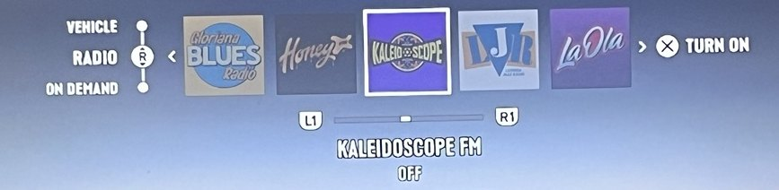
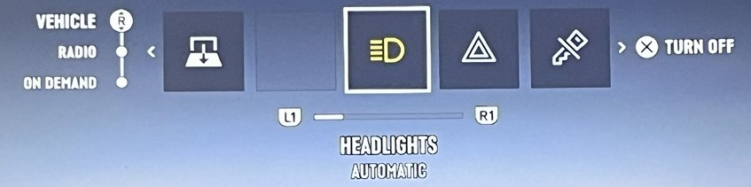
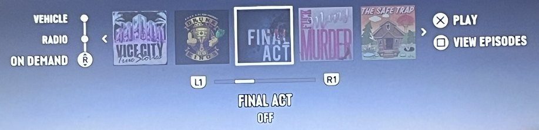

**Every car in GTA 6 has a menu with three tabs: Vehicle, Radio and On Demand.** That's where you control your headlights, hazard lights, engine and trunk, pick a radio station, or play on-demand shows with episodes, like podcasts.

## How the menu works

- **Three tabs:** **Vehicle**, **Radio** and **On Demand**, listed on the left. Flick the **right stick** to move between them.
- **Scroll** through the options with **L1** and **R1**.
- The panel in the bottom-right shows your car. Ours: **Vapid, Jason's '70 Ganado, Access: Registered**. Press **R3** to cycle through its info.

## Vehicle tab: lights, engine and trunk

The Vehicle tab controls your car itself. Scroll with **L1/R1** and press **X** to use an option:

| Control | What it does |
| --- | --- |
| **Headlights** | Set to **Automatic** by default; turn them on or off |
| **Hazard lights** | Turn your hazards on or off (the warning-triangle icon) |
| **Engine** | Turn the **engine on or off** (the key icon) |
| **Trunk** | **Open or close the trunk** |

## Radio tab: stations

Stations we've seen so far:

- **Gloriana Blues Radio**
- **Honey**
- **Kaleidoscope FM**
- **LJR**
- **La Ola**

Highlight a station and press **X** to **turn it on**. There are more to scroll through.

> [!TIP]
> Recording gameplay for YouTube? Turn on **Mute Licensed Music** in Settings, then Audio, so radio songs don't get your video claimed. See our [settings guide](article:gta-6-best-settings).

## On Demand tab: shows with episodes

- **On Demand** plays shows with **episodes**, much like podcasts.
- Shows we spotted include **Vice City True Stories**, **Final Act** and **The Safe Trap**.
- Press **X** to **play**, or **Square** to **view episodes**.
