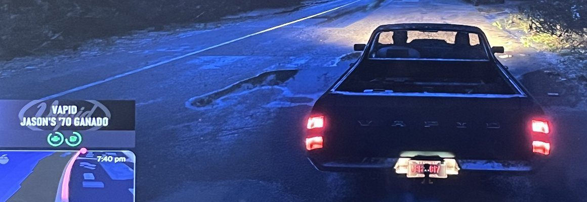
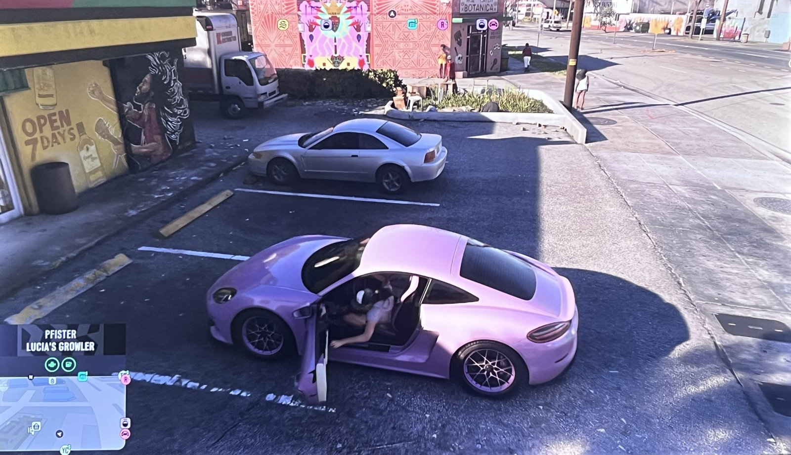

**Before launch, Rockstar has named a handful of GTA VI vehicles, all in its edition and pre-order bonus listings.** The rest of the line-up will be documented once we've driven it.

> [!CONFIRMED]
> Every name below appears on Rockstar's official Editions page or the Rockstar Store, checked November 15, 2026.

## Officially named vehicles

| Name (as Rockstar lists it) | Where it comes from |
| --- | --- |
| '95 Grotti Cheetah | Ultimate Edition |
| '67 Vapid Dominator Buggy | Ultimate Edition |
| Shitzu Squalo | Ultimate Edition |
| Ganado Retro Build | Ultimate Edition |
| Jason's Safehouse Vehicles | Ultimate Edition |
| Classic Car Collection | Ultimate Edition |
| '55 Vapid Stanier Sedan (and Garage) | Vintage Vice City Pack, the pre-order bonus |

The year prefixes ('95, '67, '55) are part of Rockstar's names.

> [!NOTE]
> Rockstar hasn't said what type of vehicle the Shitzu Squalo or Ganado Retro Build is, or which cars are in "Jason's Safehouse Vehicles" and the "Classic Car Collection." In earlier Rockstar games, Shitzu made boats and the Squalo was a speedboat, but **we're not assuming that carries over**. We'll confirm each one in the game.

## Seen in the game

| Name (as the game shows it) | What it is |
| --- | --- |
| Vapid · Jason's '70 Ganado | Jason's own pickup truck, early in the story |
| Pfister · Lucia's Growler | Lucia's own sports car |

> [!NOTE]
> Seen in our own PS5 copy on launch day. The in-game name reads "Jason's '70 Ganado" from Vapid. Rockstar's Ultimate Edition lists a "Ganado Retro Build"; we haven't confirmed whether that's the same truck or an upgraded version.

**Lucia's Growler** is a two-door Pfister sports car; ours was **pink**. Seen on our own PS5 copy.

**How we got it:** there's a **laptop in the apartment** you stay in. Find its **password** around the apartment and log in: a message there says someone **left a car** for the people who used to live there. Go to the marked spot and the car is yours.

## Vehicle-related shops

The Ultimate Edition also lists two mod shops, **Rideout Customs Mod Shop** and **One-Eyed Willie's Mod Shop**. What they offer hasn't been detailed yet. See the [editions guide](article:gta-6-editions-standard-vs-ultimate).

## Coming after launch

- A full vehicle list with categories and where to find each one.
- Rare and hidden vehicles, with locations and spawn conditions verified in the game.
- Customization and mod shop guides.
