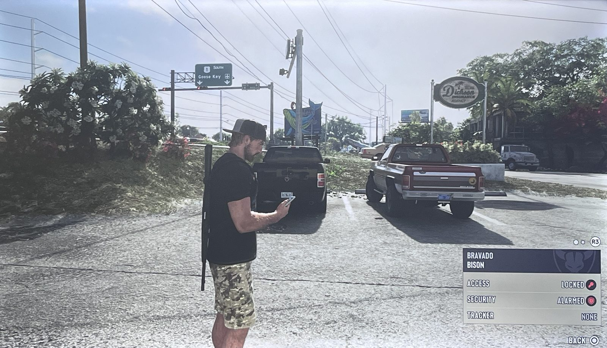
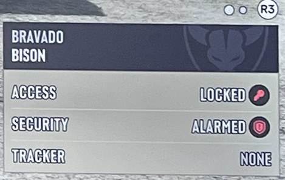

**GTA 6 lets you scan parked cars with your phone before you take them.** The scan tells you if a car is locked, has an alarm, or has a tracker. Taking cars isn't one button any more, so it pays to check first.

## What the scan shows

Our scan of a **Bravado Bison** pickup showed:

| Line | Ours showed | What it means |
| --- | --- | --- |
| Access | Locked | The doors are locked |
| Security | Alarmed | It has an alarm that can go off |
| Tracker | None | No tracker fitted |

Press **R3** to switch between scanned cars (the dots above the panel), and **Circle** to go back.

## The app's name: Waink

The default PS5 controls list a **"Waink App"** on the D-pad (see our [controls guide](article:gta-6-controls-ps5-xbox)), and gaming coverage describes Waink as the phone's car-scanning app.

**Car value:** the Waink app also shows **what a car is worth**, which we've confirmed on our own playthrough. Handy for picking which car to take.

> [!REPORTED]
> Other outlets report that tracked cars can be followed by police after you take them. We haven't seen that ourselves yet.

Tools for locked and alarmed cars (Slim Jim, key cloner): see [how to steal cars](article:gta-6-how-to-steal-cars).

## Tips

- **Scan before you grab.** An unlocked car with no alarm and no tracker is the easiest one to take.
- **Alarms bring attention.** If an alarm goes off, watch your [wanted level](article:gta-6-wanted-level).
- **Need fuel?** Taken cars still need gas: see [refueling in GTA 6](article:gta-6-gas-refuel).
