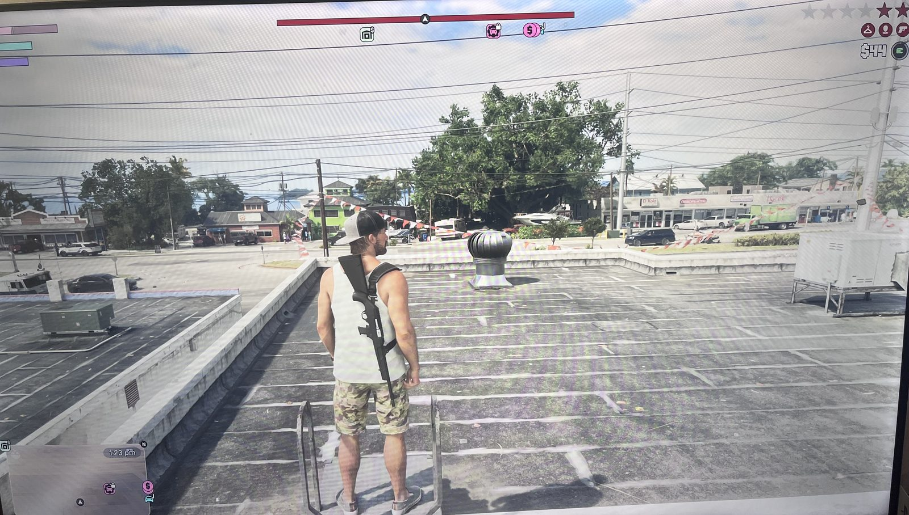
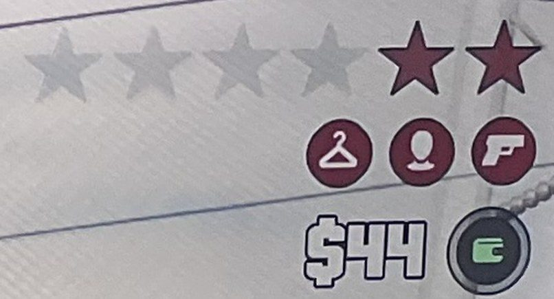
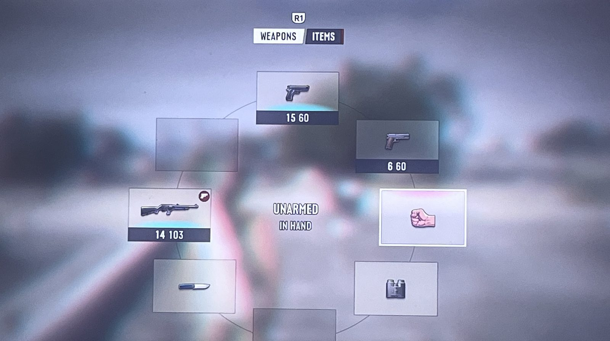

**In GTA 6 your wanted level shows as stars in the top-right corner. White stars mean the police are chasing you; red stars mean you got away but they are still searching the area.** Here is how it works, from our own PS5 copy.

## White stars vs red stars

| Stars | What it means |
| --- | --- |
| **White** | The police are **actively chasing you** right now. |
| **Red** | You **got away**, but you are **still wanted**: police are **searching the area** for you. |

There are **six star slots**; more stars means more police. Ours was at **2 stars**, in red, after escaping. While police are searching, the compass bar along the top of the screen turns **red** too. Leave the area and stay out of sight until the stars clear.

## What the police remember about you

Under the stars are icons for what the police **remember** about you:

| Icon | What they remember |
| --- | --- |
| Clothes hanger | Your **outfit** |
| Head | Your **appearance** |
| Car / vehicle | Your **car** |

In our screenshot the third icon was a **gun**, because we were on foot with a weapon. Change what they remember (a new outfit, a different car) to make yourself harder to spot. Even Brian tells Jason to go to a store "to get a change of clothes so the cops aren't all over you."

## The rest of the HUD

- **Top left:** three bars (health, plus two more meters).
- **Top right:** your **cash**, under the wanted icons.
- **Bottom left:** the minimap, with the time of day.
- **Top of the screen:** the compass, with icons for nearby places.

## Weapon wheel

Hold **L1** to open the **weapon wheel**. It has **Weapons** and **Items** tabs (switch with **R1**) and shows the ammo for each gun.

More controls: [GTA 6 controls on PS5](article:gta-6-controls-ps5-xbox).
